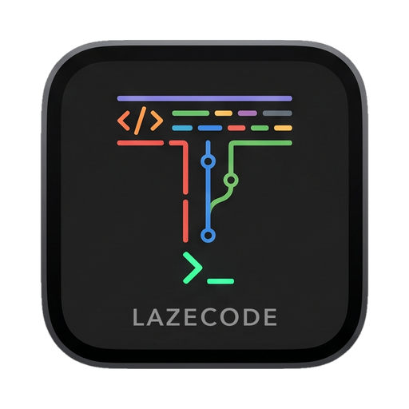

# LazeCode

[English](README.md) | [Simplified Chinese](README.zh-CN.md)

<p align="center"></p>

[](https://github.com/jiangtaiduo/LazeCode/actions/workflows/ci.yml)
[](LICENSE)

LazeCode is a macOS tool that keeps only the core surfaces: editor, Git, and
terminal. You can launch any coding agent you like in the terminal; the editor
and Git remain for the occasional case where you need to inspect or edit code
by hand. Built on Tauri 2, Monaco and the native Ghostty VT engine.

No account system, no crash reporting. The only automatic background request is
the version check; see [Privacy and network](#privacy-and-network) for the
operations that can reach the network.

> **Status: developed and tested on macOS 27. The declared minimum is macOS 13
> on Apple Silicon; macOS 13 through 26 are not tested yet. Still alpha.**
> Release builds are **ad-hoc signed but not notarized** because no Developer ID
> certificate is configured. Build from source for local use; version checks run
> at most once a day, and installation requires user confirmation
> (`Settings → Updates`).

| | |
| :--- | :--- |
| Status | `0.1.3`, alpha |
| Platform | macOS 13+, Apple Silicon (arm64); tested on macOS 27 |
| Stack | Tauri 2, Rust 1.90+, React 19, Monaco, Ghostty VT |
| License | MIT |
| Accounts / telemetry | None; local diagnostics are opt-in |
| Automatic network | Daily version check (on by default, opt-out) |

---

## What LazeCode is

LazeCode keeps three surfaces and deliberately stops there:

- **Editor** — Monaco, project tree, file watching, Find in Files and LSP
  diagnostics.
- **Git** — DAG log, branches and tags, remotes, clone, worktrees, submodules,
  LFS, commit/push/pull/fetch, merge/rebase/cherry-pick/revert, stash/shelves,
  hunk staging, and diff/history rewrite.
- **Terminal** — a native Ghostty VT engine running in the same process as the
  PTY; launch any coding agent here.

Git is a first-class surface, not a thin status viewer: log, staging, diff,
branch/tag operations, history rewrite and remote sync all live in the app.

It is not trying to be a platform: there is no account, no bundled AI provider,
no telemetry upload and no extension marketplace. Any coding agent can run in
the terminal; LazeCode does not wrap it in a proprietary chat panel. That keeps
the app small and the editor/Git workflow predictable.

The layout follows familiar IDE conventions: project tree on the left, Git and
terminal panels at the bottom, a commit drawer and Search Everywhere.
**PyCharm is the main design reference.** The goal is that a PyCharm user can
find the project tree, Git log, commit drawer, terminal and search without
learning a new mental model.

LazeCode is not affiliated with JetBrains. PyCharm is a trademark of JetBrains
s.r.o.; no JetBrains code, icons, or other assets are used.

**Topics:** `git` `ide` `rust` `git-client` `git-gui` `git-ide` `code-editor` `terminal` `terminal-emulator` `pycharm` `macos`
`apple-silicon` `tauri` `monaco` `ghostty` `local-first` `lightweight`
`pycharm-inspired` `ai-coding` `developer-tools`

## Quick start

LazeCode requires macOS 13 or later on Apple Silicon, Xcode Command Line Tools,
Node.js 22.6 or newer and Rust 1.90 or newer.

```bash
npm ci
npm run tauri dev
```

For a local ad-hoc signed app, see [Build from source](#build-from-source).

## Contents

- [What LazeCode is](#what-lazecode-is)
- [Quick start](#quick-start)
- [Why LazeCode](#why-lazecode)
- [Measured performance](#measured-performance)
- [Features](#features)
- [Privacy and network](#privacy-and-network)
- [Security posture](#security-posture)
- [Verification](#verification)
- [Build from source](#build-from-source)
- [Troubleshooting](#troubleshooting)
- [Repository layout](#repository-layout)
- [Documentation](#documentation)
- [Contributing](#contributing)
- [License](#license)

## Why LazeCode

Most browser-based IDEs embed a terminal through `xterm.js` plus `node-pty`, or
run the VT parser in WebAssembly. Both approaches add a process boundary and a
serialization hop per frame.

LazeCode links the Ghostty VT engine as a **native static library** into the Rust
process and hands the frontend a compact cell frame. There is no second
terminal process, no WebAssembly sandbox and no frame serialization across a
WebAssembly boundary. Keystrokes take one Tauri IPC call into the process that
already owns the PTY; the VT parser and PTY never leave it.

## Measured performance

These measurements were taken on different hosts. Do not compare absolute
numbers across sections; the ratios are the useful result.

### 1. WebAssembly vs native, same parser

Same workload (`engine_bench_stream` in `src-tauri/src/vt.rs`, 120,000 lines,
14.05 MB):

| Metric | wasm32 | native arm64 |
| :--- | ---: | ---: |
| Parse throughput | 9.8 MB/s | **151.5 MB/s** (15.5×) |
| Full snapshot (120×40) | 2.752 ms | **0.098 ms** (28×) |
| Per-cell read | 0.573 µs | **0.02 µs** |

The native ABI is not the WebAssembly ABI: pointers are 8 bytes, so
`GhosttyGridRef` is size 24 with `node@8`/`x@16` instead of size 12 with
`node@4`/`x@8`. Hardcoding WebAssembly-era offsets silently reads the wrong
address. See the vendored
[Ghostty integration notes](src-tauri/vendor/ghostty-vt/README.md).

### 2. Native vs xterm.js, parser only

Both parsers consumed the same 14,737,596-byte stream (`fnv1a32=8dd3affd`),
120×40, median of three runs. Neither column includes a renderer; the native
column also excludes IPC and Canvas painting.

| Workload | libghostty-vt | xterm.js headless | Ratio |
| :--- | ---: | ---: | ---: |
| Bulk write, no per-chunk overhead | **262.0 MB/s** | 111.4 MB/s | 2.35× |
| 8 KB chunks, batched queue | **278.9 MB/s** | 103.8 MB/s | 2.69× |

Recorded on an Apple M5 with xterm.js 6.0.0. A later run on the same host
measured 263.9/113.3 MB/s (2.33×) and 270.1/95.5 MB/s (2.83×). Expect roughly
±10% between runs; the ratio is more stable than the absolute number.

Reproduce with `npm run bench:terminal`. The script builds the Rust example,
writes the stream to disk, verifies that both sides hash the same bytes and
takes medians. It also records a deliberately unfair mode that `await`s every
8 KB `xterm.write`; that mode is scheduler overhead, not parsing, and is
excluded from the table.

In the real native pipeline (parse plus one incremental diff frame per 8 KB
read, a heavier cadence than 60 fps), the engine sustained 51.1 MB/s and
emitted 66.77 MB of diff for the stream. A full 120×40 snapshot costs 0.060 ms.

### 3. Headless pipeline: PTY → engine → wire → TypeScript cache

`npm run bench:pipeline` drains a real PTY (`seq 1 1500000`, 13.67 MB,
1,750 chunks of 8 KB) through the native engine, writes every diff frame, then
replays them through the TypeScript decoder and `CellDiffCache`:

| Stage | p50 | p95 | Notes |
| :--- | ---: | ---: | :--- |
| Native parse + diff | 0.274 ms | 0.336 ms | 27.8 MB/s, 1,750 frames |
| TypeScript `decodeCellDiff` | 0.001 ms | 0.003 ms | no cell copy |
| `CellDiffCache.applyDiff` | 0.010 ms | 0.014 ms | 8.40 M cells total |

Process peak RSS on this run: **44.4 MB native vs 169.2 MB xterm.js headless**.
Both figures include their language runtime, so treat them as indicative, not
parser-only memory. Canvas painting, Tauri IPC, React scheduling and UI startup
are not included; this is the engine and wire path only.

Scroll-aware diffs are intentionally **not** implemented. `libghostty-vt`'s
render state exposes dirty rows but no scroll event; viewport scrolling
therefore forces a full-row frame by design
(`scroll_viewport_marks_rows_dirty` locks this). Decoding and applying a full
120×40 frame already costs 0.003/0.014 ms p95, so the remaining scroll cost is
Canvas painting, not the frame protocol.

## Features

### Git

- DAG log with Branch/User/Date/Path filters; lane layout is computed from the
  real parent lists (`assign_graph_lanes`), not from decoration order.
- Branch tree with local and remote checkout, create, rename and delete; tags
  can be created, listed and deleted.
- Remotes, clone, submodules (add/update/sync) and worktrees.
- Commit, push, pull, fetch; merge, rebase, cherry-pick and revert with
  continue/abort; interactive rebase.
- Stash, shelves/changelists, hunk staging and amend.
- Batch file actions and batch Drop Commit. Batch drop uses one rebase todo,
  refuses a dirty worktree, and rejects merge commits and commits already
  contained in a remote branch.
- Diff viewer built on Monaco `DiffEditor`: file and commit comparison,
  generated patches, folder tree and hunk-level stage/unstage/rollback.
- Commit drawer with staged/unstaged changelists.
- Git LFS status, pull and pattern tracking.
- Credential-helper status and configuration.
- Git Tools dialog for submodules, worktrees, LFS and credentials.

### Terminal

- Native Ghostty VT engine with Kitty graphics protocol (inline images).
- Incremental cell-frame deltas (`CellDiffCache`) instead of full re-renders.
- Multi-tab and split panes, up to four PTYs per tab; scrollback search.
- Full grapheme clusters and OSC 133 prompt row flags in the cell wire format.
- Accessible text mirror (`role="log"`) for screen readers.
- Passive shell cwd tracking through OSC 7 / OSC 9 / OSC 1337, shown in the
  status bar. LazeCode does not rewrite shell rc files. OSC 133 prompt rows get a
  subtle prompt band; OSC 52 clipboard writes remain disabled.
- Generated key table from the vendored `event.h`
  (`npm run gen:key-table`).
- SGR mouse forwarding and Cmd+Click URL opening.
- Bounded per-session and global scrollback, with explicit child reaping.

### Editor

- Monaco with lazy-loaded workers; per-file text encoding and atomic writes.
- Project tree and a debounced file watcher with external-change replay.
- Find in Files (content search and replace) and Search Everywhere with a
  runnable Actions tab.
- LSP diagnostics with gutter markers.
- GitHub-flavored Markdown preview; remote images load only after a click.
- Window position, size and maximize state persist across launches
  (`window_state.rs`, with multi-monitor clamping and corrupt-file recovery).

## Privacy and network

- **No account, no telemetry upload, no crash-reporting service.**
- Local diagnostics (command names, timings, success/failure) are **off by
  default**. Enable them in `Settings → About`; the buffer stays in local
  storage and is never sent anywhere.
- The update checker runs at most once a day by default. It requests
  `https://github.com/jiangtaiduo/LazeCode/releases/latest/download/latest.json`
  and verifies the minisign/Ed25519 signature before installing anything. It
  never installs without confirmation; disable it in `Settings → Updates`.
- Remote images in Markdown are not fetched during rendering. LazeCode shows a
  “Load remote image” button and requests the image only after you click it.
- Git remotes and any language servers you configure may make their own
  network requests.
- Local data lives under
  `~/Library/Application Support/io.github.jiangtaiduo.lazecode` (window state,
  language), `~/Library/Logs/io.github.jiangtaiduo.lazecode` (`panic.log`;
  debug builds also write desktop logs) and the webview's local storage
  (settings, recents, diagnostics).
- The Git Console keeps up to 200 command summaries in memory for the current
  session, including absolute paths, branch names and search queries. It is
  not written to disk; screenshots of the Console can reveal those paths.
- Recent commit messages and favorite branches are stored in the webview's
  local storage. Clear message history from the Commit drawer.

## Security posture

Worth knowing if you plan to run repositories you do not trust:

- `read_file_content`, `write_file_content`, `fs_delete` and `fs_paste` are
  restricted to authorized workspace roots (`WorkspaceRegistry`). Out-of-root
  requests are rejected. Out-of-workspace diff targets and native-picker
  choices require a session-scoped `PathGrantRegistry` grant; grants are
  cleared when the project closes.
- Git subprocess arguments pass through `reject_option_like` and
  `--end-of-options` where applicable; destructive path arguments are rejected
  if they contain pathspec magic. Rebase todo lines are validated against a
  whitelist.
- Every `git -C <repo>` invocation is checked against registered workspace
  roots. After app startup an empty registry is **fail-closed**; only the test
  harness tolerates an empty registry.
- `git clone`, worktree-add and shelf-patch import destinations are checked
  against the workspace or a native-picker grant.
- Terminal escape sequences cannot silently reach the system: OSC 52 clipboard
  writes are not wired to a callback, OSC 8 links go through the `http`/
  `https` allowlist before `open`, and Kitty image storage is capped at 64 MB.
- Top-level navigation uses an exact scheme/host policy: local origins
  (`tauri://localhost`, `tauri.localhost`, `ipc.localhost`, development
  localhost) load in the window; external `http(s)` goes to the system
  browser; `data:`, `blob:`, `file:` and custom schemes are blocked.
- A panic hook writes the crash site to `panic.log`. The release profile uses
  `panic = "abort"`, so without the hook a crash would leave no trace.

**Threat model:** repository content is untrusted; the renderer is trusted.
The terminal and user-configured language servers can execute arbitrary
programs by design, so a fully compromised renderer is outside the isolation
boundary. The IPC checks above reduce accidental exposure from malicious
repository content; they are not a sandbox for arbitrary JavaScript.

## Verification

The Rust side speaks a binary cell frame and the TypeScript side decodes it.
Neither type system can prove that the two agree: a wrong field offset compiles
on both sides and produces garbage at runtime.

### Cross-language wire contract

The contract is checked by an executable spec,
[`src/ghostty-vt/verifyWire.ts`](src/ghostty-vt/verifyWire.ts), with **34
checks** run against fixtures parsed from the Rust source:

```bash
npm run verify:wire
```

It prints one line per check and exits non-zero on the first mismatch. The
checks cover buffer lengths, per-cell codepoints and styles, wide-character
spacers, diff rows, grapheme clusters, row flags, keyboard key values, modifier
bits and the host content-box calculation. Several checks parse
`ghostty.h`/`event.h` for the authoritative bit values instead of trusting a
comment.

A floor assertion also protects the key table: it may grow, but shrinking means
a whole key group was deleted.

### Terminal behaviour goldens

`src-tauri/tests/terminal_conformance.rs` feeds deterministic byte streams
through the native engine and compares a normalized screen snapshot — text,
cursor, non-default styles, scrollback and scrollbar — against checked-in
goldens. Coverage includes SGR/truecolor, cursor movement and erase, wide CJK,
emoji, alternate screen, scroll regions, DEC modes, OSC 52/OSC 8, scrollback,
resize, a real PTY round trip, and a seeded escape-sequence fuzz pass.

```bash
cd src-tauri && cargo test --test terminal_conformance
```

Regenerate goldens only with
`UPDATE_GOLDENS=1 cargo test --test terminal_conformance`, then review every
changed file by hand.

### Rust and UI tests

**378 Rust tests passed, 7 ignored** and **104 UI tests passed** on the reference
Apple M5 / macOS 27 host. The Rust integration tests build real throwaway
repositories and run real Git:

```bash
cd src-tauri && cargo test --locked
cd .. && npm run test:ui
```

| Module | What it locks down |
| :--- | :--- |
| `commands` | Git argument validation, path authorization, workspace races, diff streams |
| `git_menu_test` | Real-repository tag/drop/rebase/merge/cherry-pick/apply workflows |
| `vt` | Cell frame layout, diff merge, grapheme clusters, scroll, search, mouse, Kitty graphics |
| `pty` | Shell spawn, child reaping, cwd canonicalization, lock ordering |
| `window_state` | Geometry persistence, multi-monitor clamping, corrupt-file recovery |
| `lsp` / `file_encoding` / `file_watch` | LSP lifecycle, non-UTF-8 recovery, external-change replay |
| `tests/` | Cross-module regressions (UTF-8, path escape, clipboard), key/mouse bytes, terminal goldens |

The `--all` → `--branches --remotes` change is pinned by
`git_log_all_refs_excludes_stash_commits`: bare `--all` pulls in `refs/stash`
on modern Git, which drags two double-parented commits into the log and draws a
spurious three-way fork in the DAG.

### Lint and format gates

```bash
npm run check          # wire/menu/catalog/i18n/command-catalog/tsc
npm run test:ui        # Vitest + Testing Library (jsdom)
npm run verify:fmt     # cargo fmt --check
./scripts/clippy.sh    # cargo clippy --all-targets -- -D warnings
cargo test --manifest-path src-tauri/Cargo.toml --locked
```

## Build from source

### Prerequisites

| Requirement | Notes |
| :--- | :--- |
| macOS | 27, Apple Silicon (arm64). The vendored `libghostty-vt.a` is arm64. |
| Node.js | 22.6 or newer (`--experimental-strip-types` is used by the verify scripts). |
| Rust | 1.90 or newer; `rust-toolchain.toml` pins 1.90.0. |
| Xcode | Command Line Tools (linker, libc++, macOS SDK). |
| Zig | Only needed to rebuild the VT library. |

### The VT library

`libghostty-vt.a` is architecture-specific. The vendored copy is macOS arm64.
There are three ways to satisfy the build, in priority order:

1. **Point at an existing build** (keeps the repository clean and works
   cross-architecture):

   ```bash
   GHOSTTY_VT_LIB_DIR=/path/to/ghostty/zig-out/lib npm run tauri build
   ```

2. **Build from source** (requires Zig and an explicit Ghostty revision):

   ```bash
   GHOSTTY_REF=<ghostty-commit-or-tag> npm run build:vt-lib
   ```

   The script uses `mktemp`, checks out the requested revision, builds with
   `-Doptimize=ReleaseFast`, copies the library and headers into
   `src-tauri/vendor/ghostty-vt/`, and writes `build-info.txt` plus
   `SHA256SUMS`.

3. **Use the vendored arm64 library** — already in place; no action needed.

If neither (1) nor (3) resolves, the build script exits with the exact commands
instead of letting the linker emit `unable to find library -lghostty-vt`.

### Run

```bash
npm ci
npm run tauri dev
```

### Build a local app (ad-hoc signed)

Tauri runs `npm run build` first (`beforeBuildCommand`) and writes the bundle to
`src-tauri/target/release/bundle/`.

```bash
APPLE_SIGNING_IDENTITY=- npm run tauri build -- --bundles app
open src-tauri/target/release/bundle/macos/LazeCode.app
```

To produce the disk image and install it:

```bash
APPLE_SIGNING_IDENTITY=- npm run tauri build
open src-tauri/target/release/bundle/dmg/LazeCode_0.1.0_aarch64.dmg
```

Open the DMG and drag `LazeCode.app` into `/Applications`.

`APPLE_SIGNING_IDENTITY=-` creates a complete ad-hoc bundle signature.
`--no-sign` leaves only the linker's temporary signature and makes
`codesign --verify` fail. The app is still not notarized and has no Developer ID,
but it can run locally without Gatekeeper quarantine.

### Release builds

`src-tauri/tauri.release.conf.json` turns on updater artifacts. With
`TAURI_SIGNING_PRIVATE_KEY` set (in CI, never committed):

```bash
APPLE_SIGNING_IDENTITY=- npm run tauri build -- --config src-tauri/tauri.release.conf.json
```

Without a Developer ID certificate, keep `APPLE_SIGNING_IDENTITY=-` so the
bundle still has a complete ad-hoc signature. The `.app` is not notarized; see
[`SECURITY.md`](SECURITY.md) and
[`.github/workflows/release.yml`](.github/workflows/release.yml) for the current
status.

## Troubleshooting

### macOS refuses to open the app

Release builds are ad-hoc signed and not notarized. For a build you built
yourself, or one whose source and checksum you trust, right-click the app and
choose **Open**. If macOS still refuses, allow it in **System Settings → Privacy
& Security**. Downloaded copies may also carry the quarantine attribute:

```bash
xattr -dr com.apple.quarantine /Applications/LazeCode.app
```

Only clear quarantine on builds you trust.

### `unable to find library -lghostty-vt`

The vendored `libghostty-vt.a` is macOS arm64 only. Confirm the target with:

```bash
file src-tauri/vendor/ghostty-vt/lib/libghostty-vt.a
```

For another architecture, point `GHOSTTY_VT_LIB_DIR` at a matching build, or
rebuild with `GHOSTTY_REF=<commit-or-tag> npm run build:vt-lib`. See
[The VT library](#the-vt-library).

### Update checks fail

`Settings → Updates` requests
`https://github.com/jiangtaiduo/LazeCode/releases/latest/download/latest.json`.
The check fails until a release with `latest.json` and a valid signature is
published; turn it off for local builds if you do not need it.

### Where are the logs?

Release builds write `panic.log` under
`~/Library/Logs/io.github.jiangtaiduo.lazecode/` after a crash; debug builds
also write desktop logs there. Window state and the native menu language are
under `~/Library/Application Support/io.github.jiangtaiduo.lazecode/`.

## Repository layout

```text
src/
  App.tsx                 Workspace orchestration, Git operations, workspace switching
  components/             Title bar, Git panel, terminal and dialogs
  services/               IPC bridge, settings layers, updater, i18n, terminal attach
  ghostty-vt/             Cell-frame decoder, wire verifier and generated key tables
src-tauri/
  src/commands.rs         Git commands, path authorization, DAG layout
  src/vt.rs               Native VT bindings, cell frames, diff merge
  src/pty.rs              PTY sessions, child reaping, response forwarding
  src/lsp.rs              Language-server process registry
  src/file_watch.rs       Debounced workspace watcher
  src/menu.rs             Native localized menu
  src/window_state.rs     Geometry persistence
  build.rs                Resolves the VT static library
  vendor/ghostty-vt/      Headers, license and arm64 static library
docs/                     Architecture and i18n notes
scripts/                  Verification, benchmarks and the VT rebuild script
```

See [`docs/architecture.md`](docs/architecture.md) for the data flow and
security-boundary overview.

## Documentation

| Document | English | Simplified Chinese |
| :--- | :--- | :--- |
| README | [`README.md`](README.md) | [`README.zh-CN.md`](README.zh-CN.md) |
| Architecture | [`docs/architecture.md`](docs/architecture.md) | [`docs/architecture.zh-CN.md`](docs/architecture.zh-CN.md) |
| Interface language | [`docs/i18n.md`](docs/i18n.md) | [`docs/i18n.zh-CN.md`](docs/i18n.zh-CN.md) |
| Contributing | [`CONTRIBUTING.md`](CONTRIBUTING.md) | [`CONTRIBUTING.zh-CN.md`](CONTRIBUTING.zh-CN.md) |
| Security | [`SECURITY.md`](SECURITY.md) | [`SECURITY.zh-CN.md`](SECURITY.zh-CN.md) |
| Code of conduct | [`CODE_OF_CONDUCT.md`](CODE_OF_CONDUCT.md) | [`CODE_OF_CONDUCT.zh-CN.md`](CODE_OF_CONDUCT.zh-CN.md) |
| Changelog | [`CHANGELOG.md`](CHANGELOG.md) | [`CHANGELOG.zh-CN.md`](CHANGELOG.zh-CN.md) |
| Third-party notices | [`THIRD_PARTY_NOTICES.md`](THIRD_PARTY_NOTICES.md) | [`THIRD_PARTY_NOTICES.zh-CN.md`](THIRD_PARTY_NOTICES.zh-CN.md) |
| Legal notice | [`NOTICE`](NOTICE) | [`NOTICE.zh-CN.md`](NOTICE.zh-CN.md) |

`LICENSE`, `NOTICE` and the upstream Ghostty integration notes are legal or
third-party texts. The English originals remain authoritative; Chinese
translations are provided for convenience only.

## Contributing

See [`CONTRIBUTING.md`](CONTRIBUTING.md). In short:

- `npm run check`, `npm run test:ui`, `npm run verify:fmt`,
  `./scripts/clippy.sh` and
  `cargo test --manifest-path src-tauri/Cargo.toml --locked` must pass.
- Changes to the cell frame or key encoding need a matching check in
  `verifyWire.ts`.
- Keep the key-table floor assertion; deleting a key group must fail loudly.
- Key values are generated from the vendored `event.h`:
  `npm run gen:key-table`; `verify:key-table` (part of `npm run check`) fails on
  drift.

## License

[MIT](LICENSE). Third-party notices are in [`NOTICE`](NOTICE) and
[`THIRD_PARTY_NOTICES.md`](THIRD_PARTY_NOTICES.md).

Ghostty is MIT-licensed (© 2024 Mitchell Hashimoto and contributors). Monaco is
MIT. React is MIT. Tauri is Apache-2.0 OR MIT.
