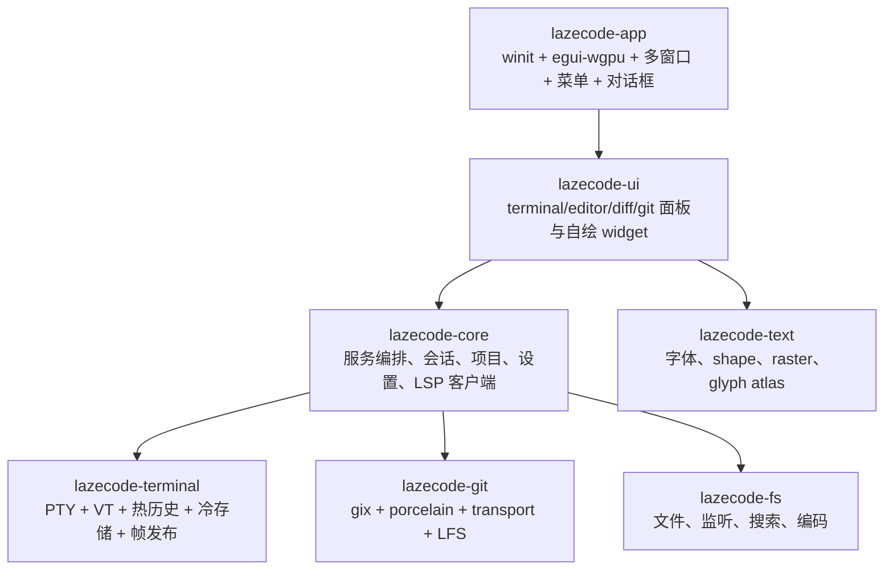
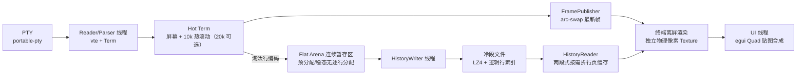
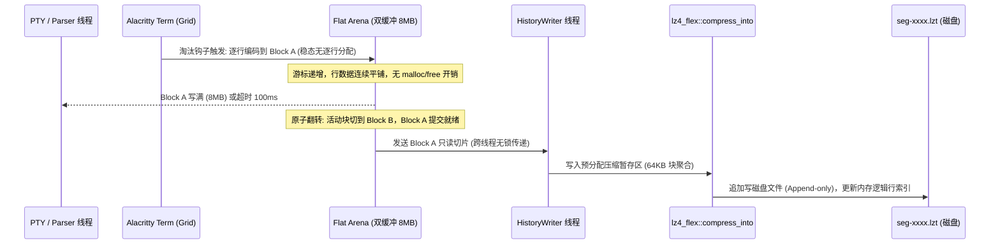
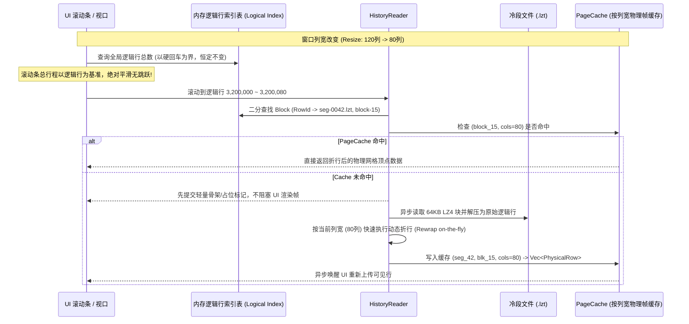
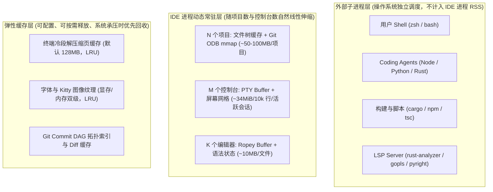
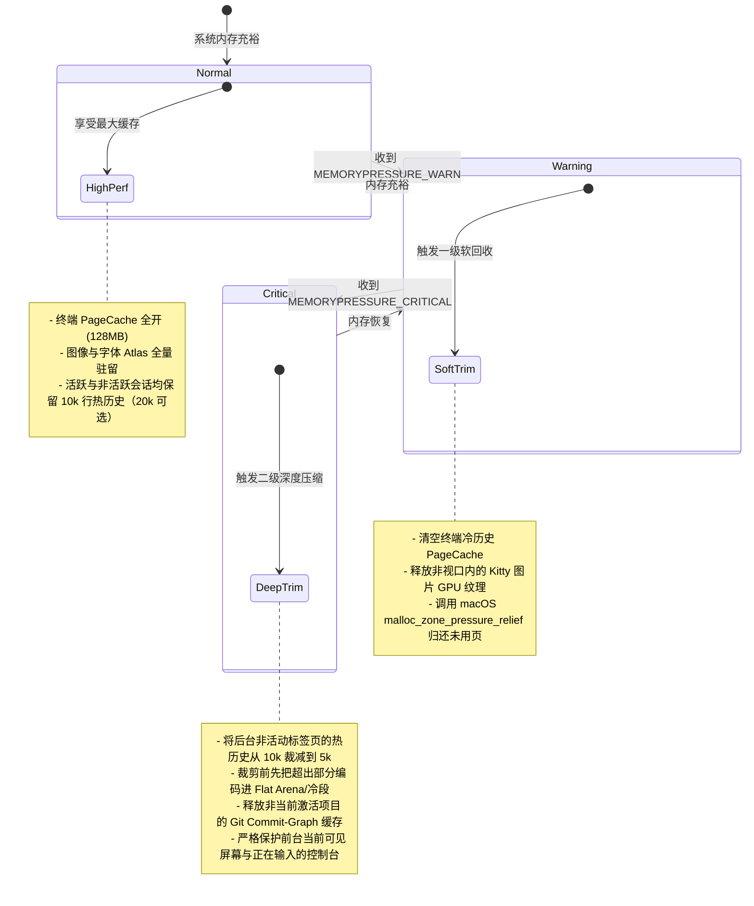

# LazeCode 纯 Rust 原生架构方案

> 状态：第一版原生应用已在 `feat-rust` 分支实现（UI、编辑器、项目/文件、Git 读写子集、终端）；旧的 Tauri/React/Monaco 树已从工作区移除，文中对 `src/`、`src-tauri/` 的引用仅保留为历史迁移说明。本文件仍是目标架构与验收基线，已实现范围和**显式未实现项**见 [`../implementation-status.md`](../implementation-status.md)。文中被标注为“未验证”的 gix/fork/传输项仍然没有当作已实现。
>
> **审计记录（2026-11-03）**：本版关键数字与 API 已按 `alacritty_terminal 0.26.0`、`vte 0.15.0`、`egui-wgpu/egui-winit 0.37.0`、`gix 0.90.0` 源码、`gix-v0.90.0/crate-status.md`、crates.io 元数据和本仓库实测复核。仍未验证/不可当作“已实现”的项：`gix-index` 扩展写回、`gix-blame` parity、`russh` 纯 Rust crypto、`gunnar-sendpack` 成熟度、Kitty graphics fork 工作量；详见 §7、§12、§16。
>
> 目标：去掉 WebView、JavaScript 和 Monaco，应用逻辑全部使用 Rust；控制台（终端）以高性能和超长输出稳定性为第一优先级；内存哲学以“在功能稳定且性能高的前提下尽可能减少内存”为核心原则，正视内存占用与打开的项目数、控制台会话数及控制台子进程数强相关的客观规律，不搞僵化的全局硬死卡，但彻底杜绝无界泄露，确保超长输出进入平台期，各级缓存具备自适应淘汰与操作系统内存压力响应能力。
>
> 本文不设开发工期。所有阶段只描述工程顺序和验收门禁，不描述日历时间。

---

## 0. 结论摘要

1. **UI 用 `winit + egui-winit + egui-wgpu + wgpu`，不用 WebView，也不用 `eframe`。** 多窗口、原生菜单、终端自绘和自定义事件路由都需要直接控制 `winit` 事件循环；`egui` 只负责应用外壳、面板、对话框和表单。**终端采用独立物理像素离屏纹理（Offscreen Blit）**，由自定义 renderer 在 egui 主 pass 之前渲染，再作为纹理贴入 egui；编辑器先用 egui mesh 自绘，不默认再开一层离屏。IME 先走 `winit`/`egui` 事件，不在 `winit` 的 `NSView` 上另实现一套 `NSTextInputClient`；`egui-winit 0.37` 已把 `ime.cursor_rect` 转发到 `Window::set_ime_cursor_area`，只有复现具体 macOS bug 才 patch `winit`/overlay，不默认改 `winit`。
2. **终端内核复用 `alacritty_terminal`，按子系统做 fork，不自己从零写 VT。** `alacritty_terminal` 已经提供成熟的网格、字符宽度、选择、滚动、damage、OSC 52、kitty 键盘协议和搜索；缺的是 APC（Kitty graphics）、OSC 133 和"历史行被淘汰"回调。fork 按 patch 序列 + conformance 管理（§5.3），其中 RowId/重排映射与 kitty 图片是最大的侵入面；kitty 图片是 parity 必做，OSC 1337/Sixel 不做。**`alacritty_terminal` 的 `Cell` 实测为 24B（`Row<Cell>` 32B，`Row` 内含每行 `Vec<Cell>`），20k 行 @120 列约 68MiB/pane，不是旧稿 16.6MB；当前 libghostty 线格式是 8B/cell（`WIRE_CELL_LEN=8`，`src/ghostty-vt/cellFrame.ts:46`；`vt.rs` 的 `packed_cells` 也是 8B），20k@120 的 cells 原始量约 19.2MB decimal（18.3MiB），不含行头/样式/字素簇；16.6MB/16B 的口径不成立。且历史是滚动时按批增长的不是一次性预分配，因此默认热历史改为 10k 行，20k 作为可选。**
3. **超长输出靠"热内存 + 冷磁盘"分层，淘汰管道走 Flat Arena 预分配、稳态无逐行堆分配（steady-state no per-row heap allocation；不是绝对 zero-allocation，也不是 zero-copy）。** 默认热层保留屏幕 + 10k 行（20k 可选）；溢出部分由 Flat 连续环形缓冲批量进入后台 LZ4 压缩段文件，消灭每秒数十万行的堆分配风暴；视口与滚动条以**逻辑行（Logical Lines）**为基准，冷区按块按需折行。冷存默认全局 32GB、单会话 16GB；**10M 逻辑行 @120 列是保留目标，10GB 原始输出是写入 soak，不承诺两者同时全量保留**。内存随活跃会话数弹性扩展，超长输出平稳进入平台期。
4. **编辑器用 `ropey + syntect + 自研视图层`，tree-sitter 不用，LSP 只保留 11 种语言。** `tree-sitter` 是 C 库，违反本方案的"纯 Rust"约束；LSP server 是用户启动的外部进程，与本方案对 shell/hooks 的定位一致，`lsp.rs` 本来就是纯 Rust 客户端。**TS/JS/JSON/CSS/HTML 只做 `syntect` 语法高亮，不接外部 LSP、不引入 Node**；补全/诊断/hover/跳转/重命名/格式化对 Web 语言显式不做。LSP 11 种语言作为可选增强，不阻塞编辑器打开/保存/高亮/搜索。
5. **Git 用 `gix`（gitoxide）做底层，porcelain 状态机独立立项，范围对齐当前产品而不是"完整 Git"。** `gix 0.90` 覆盖 clone/fetch/status/diff/merge 原语与基础单文件 blame；`push`、checkout 编排、merge 工作流、rebase/cherry-pick/revert、stash、hooks、remote/branch 写回等必须在 core 中建立成熟的 Sequencer 状态机。传输层默认只用 `russh`；系统 OpenSSH 仅作为非默认 `system-ssh-compat` feature，开启后不再属于纯 Rust 传输路径。LFS 的 status/pull/track 以及 **smudge/clean** 全部自实现，不能把 LFS checkout 回归留到 M7。
6. **最大的工程风险不是 UI，也不是终端，而是 Git porcelain 与传输层。** 如果"全部功能 + 纯 Rust"是硬约束，Git 必须按独立子系统设计、独立测试、独立验收；不能把它当成"换个 crate 就完成"。
7. **禁止静默功能回退**：每个现有能力要么迁要么显式写"不做"并给理由（§8.8 对齐表）；TS/JS/JSON/CSS/HTML 语义不做属于显式产品决策，不是遗漏。质量门禁（rust-discipline 脚本、`verifyWire.ts` fixtures oracle）随 M3/M1 迁移，规则不减。

---

## 1. 目标、约束与非目标

### 1.1 目标

- macOS 原生应用，无 WebView、无 JavaScript、无 Monaco。
- 终端支持多标签、分屏、滚动历史、搜索、选择、复制、鼠标、IME、OSC 133、超链接、Kitty 图片。
- 终端能在单个 pane 下承受 **10,000,000 逻辑行 @120 列** 的保留历史，以及 **10GB 原始输出** 的写入 soak；输出高峰不阻塞 UI，内存进入平台期。默认热历史 10k 行/会话，20k 可选。
- 编辑器支持打开/保存、编码检测、语法高亮、多光标、撤销/重做、查找替换、diff/merge、blame、Markdown 预览、图片预览。
- Git 功能对齐当前产品：日志 DAG、状态、diff、暂存、提交、分支/标签、remote、clone、push/pull/fetch、merge/rebase/cherry-pick/revert、stash/shelves、hunk staging、worktree、submodule、LFS、history rewrite。
- LSP 客户端只保留现有 11 语言，作为可选增强；TS/JS/JSON/CSS/HTML 只做语法高亮，不做语义功能，不引入 Node LSP。
- 所有长任务可取消、可观测、可恢复；任何队列都有界。

### 1.2 约束

- 应用逻辑 100% Rust。
- 不嵌入 WebView；不加载 HTML/CSS/JS。
- 不链接 C/C++ 库；系统 API 通过 Rust binding 调用（`objc2`、`winit`、`wgpu` 的 Metal 后端）。**唯一 native 例外是审计过的 crypto 后端**（`ring`/`aws-lc`，或明确选定并审计的 RustCrypto provider；当前 `rustls-rustcrypto` 只有 0.0.2-alpha，见 §1.3）；除此之外不加项目自带 C/C++ 库。
- 默认不依赖外部 `git` 可执行文件；测试可用系统 `git` 作为 oracle。
- 默认不依赖外部 `ssh` 或 `git-lfs`；系统 OpenSSH 只允许作为非默认 `system-ssh-compat` feature（开启后不属于纯 Rust 传输，见 §1.3/§7.3）。
- LFS 的 `status`/`pull`/`track`/`smudge`/`clean` 全部自实现；不执行外部 `git lfs` 数据路径。
- 不使用 `tree-sitter`、`libgit2`、`curl`、`onig` 等 C/C++ 依赖。
- 内存原则：不设僵化的全局硬死卡，而是在功能稳定与高吞吐前提下尽可能减少内存；消除泄漏，所有缓存具备明确淘汰策略和系统内存压力响应降级能力。

### 1.3 “纯 Rust”的准确含义

macOS 上不存在零 FFI 的 GUI：窗口、IME、字体枚举、菜单、Metal 都最终调用系统框架。本方案的“纯 Rust”分三层：

> 1. **应用实现层**：UI、编辑器、终端、Git porcelain、Git transport、LFS、配置、更新器全部 Rust。
> 2. **系统层**：AppKit/Metal/CoreText/剪贴板/PTY 通过 Rust binding 访问；**审计过的 crypto 后端是唯一允许的 native 依赖例外**。
> 3. **用户外部进程层**：用户主动启动的 shell、coding agent、LSP server、Git hooks、credential helper 属于外部进程，不算应用实现。

默认构建**禁止外部 `git` 和外部 `ssh`**。系统 OpenSSH 只允许作为显式 `system-ssh-compat` feature，默认关闭；开启时 UI 必须标注“使用系统 OpenSSH，不属于纯 Rust 传输路径”，不能自动静默回退。

如果要求“连 crypto 的 C/asm 后端都不能有”，TLS/SSH 必须改用 RustCrypto 并单独审计；但当前 `rustls-rustcrypto` 只有 0.0.2-alpha（2024），不能当生产默认。本项目不假设这是零成本的。若要求“任何外部可执行文件都不能有”，则 shell、LSP、hooks 也都不成立，需要另行定义产品边界。

### 1.4 非目标

- 不做 tree-sitter 语义解析、语义高亮、code action（无 LSP 参与的纯启发式高亮仍属本地算法，不受此限）。
- **不做 TS/JS/JSON/CSS/HTML 的 LSP 语义功能**：补全、诊断、hover、跳转、重命名、格式化、document symbols 全部不迁移；这些文件只保留 `syntect` 语法高亮、括号匹配、折叠、搜索、diff/merge。不引入 `typescript-language-server`、`vscode-json-languageserver`、`vscode-css-languageserver`、`vscode-html-languageserver`，也不引入 Node 运行时。
- 不做 Monaco 级别的 minimap、sticky scroll、bracket pair colorization。
- 不做插件市场、账号、云端同步、遥测上传。
- 不做扩展系统：现有 `.lazecode/extensions` 清单解析（`src-tauri/src/extensions.rs`）目前无 UI 调用方，本次迁移显式排除，不移植、不预留执行器；如后续单独立项再评审。
- 内存伸缩承诺（见 §9.3 弹性自适应模型）：默认 10k 热历史下，典型 6 会话 + 2 项目 + 3 编辑器约 **0.8–1.1GB**；20k 可选时约 **1.0–1.2GB**。idle 目标 80–150MB。杜绝无界增长，确保超长输出进入平台期。

### 1.5 目标（LSP 篇）

- 只保留现有 11 种语言：`python/go/rust/c/cpp/java/ruby/php/kotlin/swift/lua`，候选表与 `src/services/lsp.ts` 一致，候选回退逻辑不变。
- **LSP 是可选增强**：没有 server 时编辑器正常打开/保存/高亮/搜索，不报错、不阻塞；LSP 只影响补全/诊断/hover/跳转/重命名/格式化。
- `lsp.rs` 的进程生命周期（注册表、spawn、stdout 泵、stop/退出清理）迁入 `lazecode-core`，把 `tauri::Emitter` 换为 core 事件总线。
- 编辑器侧实现 JSON-RPC 客户端（diagnostics、completions、hover、goto、rename、format、document symbols），渲染交给 egui 面板。
- **TS/JS/JSON/CSS/HTML 不进 LSP 候选表，不启动外部 server，不需要 Node。**
- LSP server 崩溃不影响主进程；日志与进程 RSS 采样沿用现有 `process_rss_kb` 归因设计。`pyright/gopls/rust-analyzer` 三个 e2e 作为回归测试，不作为编辑器打开/保存的硬 gate。

---

## 2. 当前实现与迁移边界

当前应用是 Tauri 2 + React 19 + Monaco + WebKit。实测（macOS 27 arm64，0.2.0；采集方式：`footprint` 工具逐一窗口采样 + 系统设置里的内存视图，数字为观察值非严格基线）：

- 全新空白窗口：约 109MB footprint。
- 运行 19 小时、6 个 shell 后：主进程约 269MB，WebContent 约 1026MB，GPU 约 109MB，合计约 1.4GB。
- WebContent 的构成大致是 WebKit Malloc、graphics、WASM、JIT；主进程的大头是终端网格与滚动历史。

补充当前代码与依赖实测（用于校正旧口径）：

- 当前 Rust：19 个文件 33,272 行；TS/TSX：157 个文件 49,357 行（不是旧稿的 33k）；`#[tauri::command]`：`commands.rs` 138 个、整个 `src-tauri/src` 177 个（`pty.rs` 26、`ghostty.rs` 5、`lsp.rs` 4、`file_watch.rs` 2、`file_range.rs` 1、`extensions.rs` 1）；`commands.rs` 15,952 行、`vt.rs` 6,399 行、`pty.rs` 2,836 行。
- 当前 Git 执行层是 `git` CLI（`commands.rs` 中 `git` 相关出现 1,401 处），所以换成 `gix` 不是“替换一个 crate”，而是重写全部 porcelain 的数据来源。
- 当前 LSP：`lsp.ts` 11 种语言；`monacoLspClient.ts` 另有 TypeScript/JavaScript（5 个 server）。本方案只保留 11 种，TS/JS 语义显式不做。
- `alacritty_terminal 0.26.0` 实测：`size_of::<Cell>() = 24`、`size_of::<Row<Cell>>() = 32`；`scrolling_history = 20_000`、120 列、40 行时，临时 probe 的 peak footprint 约 68.2MiB、max RSS 约 69.0MiB。**旧稿的 20k@120 ≈ 16.6MB 与当前 libghostty 的 8B/cell 和 16B/cell 两种口径都对不上；当前线格式是 8B/cell，20k@120 的 cells 原始量约 19.2MB decimal（18.3MiB），不是 16.6MB。**
- 同一 probe 的纯解析吞吐约 177MB/s（64MB 合成 SGR 文本）；这只证明 parser 本身不慢，不替代包含 diff/帧发布/渲染的全管线基准。

> 已有的终端性能基线（本机 Apple M5，`npm run bench:pipeline` 产物 `src-tauri/target/bench/pipeline.json`，链路：真实 PTY → libghostty-vt 解析 → 差分帧 → 前端 CellDiffCache 合并；不含 Tauri IPC/React/Canvas）：负载 13.67MiB / 1750 块，**原生解析+差分 46.1 MiB/s（块 p50/p95/max = 0.163/0.217/0.724 ms）**，前端解码合并 p95 0.003/0.014 ms，峰值 RSS 原生 44.3MiB vs xterm.js 169.1MiB。终端吞吐 gate（§5.6.5/§5.8）必须以此为对照："不慢于该基线"为 gate，"≥100MiB/s"为 stretch。

迁移时可以复用的 Rust 资产：

- `portable-pty` 的 PTY 会话管理、进程组、退出清理。
- 文件读写、编码检测、分页读、文件监听、搜索、路径授权。
- Git 操作的业务语义、参数校验（`reject_option_like`/`reject_refspec_like`/`authorize_git_*`）、错误码、测试用例（但执行层要从 `git` CLI 换成 `gix`，安全校验语义必须原样保留）。
- LSP 生命周期：`lsp.rs` 的注册表/spawn/stdout 泵/stop 清理迁入 core，按语言候选回退逻辑保留。
- `lsp.rs` 之外的进程纪律设施：`run_with_timeout_spawn`、进程组 kill、reaper 线程——双用途（Git 测试 harness + LSP/外部进程），直接迁入 core。
- 设置分层、i18n 文案、窗口状态、更新器签名校验的设计。
- 终端键盘表、OSC/cwd 跟踪、a11y 文本镜像的产品需求。
- 内存纪律：`pty.rs` 的"全局 scrollback 预算 + 按活跃会话 rebalance"语义（§5.5.1 与 §9.3 沿用此口径）。

不能复用：

- `libghostty-vt`（Zig 静态库）——纯 Rust 约束下必须替换。
- Monaco/React/所有 TS UI——按本方案重写。
- Tauri IPC 层——同进程直接调用，不再需要命令序列化。

---

## 3. 总体架构

### 3.1 Crate 划分



> LSP 客户端驻留 `lazecode-core`（复用 `lsp.rs` 生命周期与分帧逻辑），不单独设 crate：它是 core 服务的直系（进程注册表 + 事件泵），UI 只消费 provider 结果。

建议的 workspace：

| crate | 职责 | 关键约束 |
|---|---|---|
| `lazecode-app` | `winit` 事件循环、窗口管理、原生菜单、快捷键、全局状态 | 不阻塞；不直接做 I/O |
| `lazecode-ui` | egui 面板、对话框、terminal/editor/diff 自绘控件 | 只读快照，不持有会话锁 |
| `lazecode-core` | 项目、会话、命令、设置、布局、更新器编排、**LSP 客户端（`lsp.rs` 迁移）** | 无 UI 依赖 |
| `lazecode-terminal` | PTY、VT、热网格、历史冷存储、帧发布 | 每会话独立线程；队列有界 |
| `lazecode-text` | 字体发现、fallback、shaping、raster、atlas | 纯 Rust；线程安全缓存 |
| `lazecode-git` | gix 封装、porcelain、传输、LFS、hooks | 写操作按仓库串行；输入校验语义平移 |
| `lazecode-fs` | 文件范围读、缓存、watch、search、编码 | 路径授权；缓存有界 |
| `lazecode-testkit` | Git oracle、终端 fixture、性能 harness | 仅测试使用系统 `git` |

### 3.2 事件与数据流

- UI 线程：`winit` 事件 → `egui` 输入 → 各面板绘制。
- 终端：PTY 读线程 → VT 解析 → `Term` → 帧发布 → UI 读取最新帧。
- 终端历史：`Term` 淘汰行 → 有界队列 → 历史写线程 → 段文件。
- LSP：UI 发请求 → core LSP 客户端（注册表 + stdio 泵）→ provider 结果经事件总线 → UI 面板（诊断/hover/补全）。
- Git：UI 发命令 → Git worker → 结果/进度 → UI；写操作按仓库串行。
- 文件：`notify` → 去抖 → UI 事件。
- 网络：tokio → 更新器/LFS/Git HTTP/SSH → 进度/结果。

所有跨线程通信使用有界通道；UI 只读取最新状态，不排队历史帧。

---

## 4. 技术选型

### 4.1 主选型

| 领域 | 选型 | 说明 |
|---|---|---|
| 窗口/事件 | `winit` | 直接控制多窗口、菜单、拖放、IME |
| UI 外壳 | `egui` + `egui-winit` + `egui-wgpu` | 立即模式，无长期 DOM；终端用自定义 renderer 的离屏纹理，编辑器先用 egui mesh |
| GPU | `wgpu` | Metal 后端；与 egui 共享 device/queue |
| 终端 VT | `alacritty_terminal` 0.26 最小 fork | 成熟、快、纯 Rust；`Cell=24B`，默认 10k 热历史；补 APC/OSC 133/eviction |
| VT 解析 | `vte` 0.15 最小 fork | 补 APC dispatch；保持上游兼容 |
| PTY | `portable-pty` | 已在用；进程组/退出清理成熟 |
| 文本 | `fontdb` + `rustybuzz` + `swash` | 系统字体、shaping、光栅化、彩色 emoji |
| 编辑器 buffer | `ropey` | 稳定 rope；大文件另走分页 |
| 语法高亮 | `syntect` 5.3（`default-fancy`） | 纯 Rust fancy-regex；不用 onig；Web 语言只做语法高亮 |
| Diff | `similar` / `imara-diff` | 行 diff；可增量 |
| 3-way merge | `diffy` 或自研 | merge 结果与冲突块 |
| Git | `gix 0.90` + 自研 porcelain | 范围对齐 `commands.rs` 138 / 全后端 177 个 command；见第 7 节 |
| SSH | `russh` + `gix-transport` 自定义 transport | 默认唯一传输；系统 OpenSSH 仅非默认 `system-ssh-compat` feature；需审计 crypto 后端 |
| HTTP(S) | `reqwest` + `rustls` | 更新器、LFS、Git HTTPS；crypto 后端按 §1.3 审计 |
| 历史存储 | 自研段文件 + `lz4_flex` | 追加写、块压缩、索引；默认热 10k、冷全局 32GB |
| 应用 KV | `redb` | 纯 Rust 嵌入式 KV；替代 SQLite/localStorage |
| 并发 | `crossbeam-channel`、`arc-swap`、`parking_lot`、`rayon`、`tokio` | 有界队列、最新帧、工作池 |
| 菜单 | `muda` | 原生 macOS 菜单 |
| 文件对话框 | `rfd` | NSOpenPanel/NSSavePanel |
| 剪贴板 | `arboard` 或 `objc2-app-kit` | 现有 objc2 代码可复用 |
| 更新 | `reqwest` + `rustls` + `minisign-verify` | 自签名 manifest、原子替换 |
| 打包 | `cargo-packager` | .app/.dmg；CI codesign/notarize |
| 日志 | `tracing` + `tracing-appender` | 结构化日志、滚动文件 |
| 指标 | `sysinfo` + 自研计数器 | 内存、线程、队列深度、吞吐 |
| 测试 | `cargo test`、`proptest`、`cargo-fuzz`、`egui_kittest`、`insta`、`criterion` | 见第 10 节 |

### 4.2 为什么不用其它 GUI

| 方案 | 结论 | 原因 |
|---|---|---|
| Tauri + React + Monaco | 否决 | WebView 稳态内存和 IPC 边界是本次改造对象 |
| `eframe` | 否决 | 多窗口、原生菜单、自定义事件路由需要直接控制 `winit`；`eframe` 的窗口/菜单抽象不匹配，不是“不能画自定义几何” |
| `floem` | 否决 | Lapce 在用，但 0.2.0、API 变动大、生态小；自绘终端仍需自己写 |
| `gpui` | 否决 | 与 Zed 强耦合，第三方 API 不稳定；GPU 内存也不低 |
| `iced` | 否决 | 文本编辑器控件弱，自绘终端仍需大量工作 |
| `slint` | 否决 | 授权与自定义编辑器成本；不适合作为底层框架 |

### 4.3 纯 Rust 的坑

- `syntect` 默认 feature 是 `default-onig`，会拉 C 的 onig。必须：
  ```toml
  syntect = { version = "5.3", default-features = false, features = ["default-fancy"] }
  ```
- `egui_dock` 0.21.1 依赖 `egui ^0.36`，而 `egui` 最新是 0.37；直接引入不可行。处理顺序按 §8.2：先 spike"从 egui_dock fork dock 逻辑并解除 egui 版本耦合"，撞墙再自研 `DockTree`；spike 结论回写 §8.2/§13 后生效（§13 已设为非默认自研）。
- `tree-sitter` 是 C；本方案不用。
- `alacritty_terminal` 不支持 Kitty graphics，`vte` 不派发 APC；需要 fork 补钩子。
- `gix` 是 pre-1.0，API 会变；必须锁版本并保留升级测试。
- `rustls`/`russh` 的 crypto provider 默认是 `aws-lc-rs` 或 `ring`（含 C/asm）。如果“纯 Rust”要求无 C，需要选 RustCrypto provider 并单独审计；但 `rustls-rustcrypto` 目前只有 0.0.2-alpha（2024），不能当生产默认。否则把 crypto 视为已审计的系统 native 例外。默认构建不允许外部 `ssh`；系统 OpenSSH 只作为非默认 `system-ssh-compat` feature，不能静默回退。
- `alacritty_terminal` 的 `Cell` 是 24B、`Row<Cell>` 是 32B；20k@120 实测约 68MiB/pane，不是旧稿 16.6MB。当前 libghostty 线格式是 8B/cell（20k@120 的 cells 约 19.2MB decimal），不要拿旧数字做预算。默认热历史用 10k，20k 只作为可选。
- `egui_wgpu::Callback` 的 `paint` 只拿到当前 render pass；但 `CallbackTrait::prepare`/`finish_prepare` 拿到 `&mut wgpu::CommandEncoder`，可以在 egui 主 pass 之前录制自己的离屏 pass。终端仍建议用自定义 renderer 做显式两段式排序/纹理生命周期，但理由不是“Callback 不能开 pass”。
- 不要在 `winit` 的 `NSView` 上另实现一套 `NSTextInputClient`；先吃 `winit`/`egui` 的 IME 事件。`egui-winit 0.37` 已把 `ime.cursor_rect` 转发到 `Window::set_ime_cursor_area`，不默认 patch `winit`；只有复现具体 macOS bug 才 patch/overlay。
- `syntect` 要验证 TS/JS/TSX/JSX/JSON/JSONC/CSS/SCSS/Less/HTML 的语法定义；缺的 vendor `.sublime-syntax`，仍然纯 Rust，不引入 tree-sitter。

---

## 5. 终端子系统（核心）

### 5.1 目标与硬指标

- 单 pane 保留 **≥ 10,000,000 逻辑行 @120 列**；同时支持 **10GB 原始输出** 的写入 soak。默认热历史 10k 行/会话，20k 可选。
- UI 在旧引擎基线量级（46MiB/s，§5.6.5）的输出高峰下保持 60fps；按键回显 p95 < 16ms。更高吞吐（≥100MiB/s）为 stretch 目标，依据见 §5.6.5。
- 内存不随输出线性增长；默认 10k 热历史约 34MiB/pane，20k 约 68MiB/pane；热历史 + 缓存进入平台期。
- 任意时刻只有一个可见屏幕需要渲染；不得遍历完整历史。
- 关闭 pane/tab 立即释放 PTY、网格、历史索引；历史文件按 §5.5.9 策略保留或删除。
- 崩溃/强制退出后，已落盘历史可恢复；未落盘的最近输出允许丢失，但不能损坏已有段。

### 5.2 分层



关键原则：

- **解析在 reader 线程完成**，UI 只拿可见行快照，不做 VT 解析。
- **淘汰管道走 Flat Arena 预分配 + 稳态无逐行堆分配（不是绝对 zero-allocation，也不是 zero-copy）**：历史行离开环形缓冲区时，把 24B 的 `alacritty::Cell` **编码/序列化**到预分配 Arena，避免每行创建 `Box`/`Vec`。`Cell` 含 `Arc<CellExtra>`，禁止对 `Cell` 做 raw `memcpy`。`CellExtra` 的 zerowidth/hyperlink、单行超出 block、块满回压仍需要**有界 fallback**，不能宣称所有路径绝对零分配。
- **终端与编辑器渲染路径分离**：终端用自定义 renderer 的离屏物理纹理；编辑器先用 egui mesh 自绘，不默认再开一层离屏。只有终端需要独立 Pipeline/BlendState 和整数像素对齐。
- **视口与滚动条基于逻辑行（Logical Lines）**：无论窗口如何缩放重排，逻辑行总数保持不变，冷历史按块按需动态折行，彻底消除滚动条跳变与全盘重排开销。
- **UI 永不等待磁盘**：滚动到冷区时先显示占位，异步取页。

### 5.3 VT 引擎：fork 还是自研

结论：**fork `alacritty_terminal` + `vte`，不自己从零写 VT。**

理由：

- VT 兼容性是长期 correctness 风险；`alacritty_terminal` 已被 Alacritty 大规模使用，网格、宽字符、选择、滚动、damage（`TermDamage::Full/Partial`；`Term::scroll_display` 改变 `display_offset` 时会 `mark_fully_damaged`，不要只看 `damage()` 返回值就假设 `display_offset != 0` 一定自动 Full）、OSC 52、kitty 键盘协议、搜索（`term/mod.rs` 的 `search` + regex）都比较成熟。**但 0.26 无 APC/kitty graphics**（terminfo.dev 亦确认 alacritty 主线无 kitty graphics），图片子系统全靠 fork 自己写（§5.3/§15.4.2）。
- 自研 VT 需要重做字符集、模式、DCS/OSC、宽字符、重排、alt screen、鼠标协议、粘贴、搜索等，工作量远大于改动成本。
- `wezterm-term` 功能更全（含图片），但未在 crates.io 发布、与 WezTerm 配置耦合、API 更重；不作为主选。
- `vt100` 功能不足。

fork 策略：

- 仓库内 `crates/lazecode-vt`，基于 `alacritty_terminal 0.26`（Apache-2.0），保留 LICENSE/NOTICE。
- 仓库内 `crates/lazecode-vte`，基于 `vte 0.15`，加 `apc_dispatch`。**实况（源码核实）**：`vte 0.15` 进入 `SosPmApcString` 态后 payload 字节被 *静默忽略*（`anywhere()` 只处理 `0x18/0x1A/0x1B`，`0x9C`(ST)/BEL 不进入闭合路径）；`Perform` 只有 `hook/put/unhook`（DCS 用），**不存在 `apc_dispatch`**——fork 实质是把 APC payload 缓存起来，在 ST/BEL 闭合时对 `Perform` 调 `apc_dispatch(payload)`；crates.io 另有 `vte-graphics 0.15.0`（alacritty graphics patch 的 fork，许可证同 vte），**引入前必须核对 license 与维护活跃度**，可评估作为 fork base 省一趟 patch。
- 补充：APC/kitty graphics 的载荷经 base64→PNG 解码进 `ImageStore`（§5.5.7），与 `Term` 网格坐标耦合；hook 侧只负责把 payload 送出来。改动的 conformance 与现有 fixtures 对齐（§8.9 oracle）。
- 只维护最小 patch set，每季度同步上游；所有 patch 有测试覆盖。
- **fork 体量约束**：钩子 4（RowId/宽表元数据）与图片子系统（上表"图片协议"条目）合计是 fork 里最大的侵入面，必须拆分 patch 序列、每个 patch 一个 conformance 测试文件；按子系统计工作量，不按"只加钩子"计。上游同步以"patch 序列逐个 rebase"为准，拒绝 squash 合并（否则季度同步退化为重写）。
- **内存口径以 alacritty 为准**：本地实测 `Cell = 24B`、`Row<Cell> = 32B`（`Row` 内含 `Vec<Cell>`，每满行额外一次堆分配）；20k@120 **满填**时约 68–73MiB/pane。**但历史不是一次性预分配**：`Storage::initialize` 只在滚动时按 `max(N, 1000)` 增量扩容（0.26 源码），所以实际 RSS 峰值是"写过多少行就有多少"，真长时间 soak 会到上限值——内存承诺按满填口径写验收，不按初始分配。默认热历史 10k（约 34–36MiB/pane），20k 可选；不要再用旧稿 16.6MB 作为任何一方的证据。
- **淘汰钩子不能只挂 `shrink_lines`**：正常滚屏路径是 `Grid::scroll_up`：历史满时 `increase_scroll_limit` 为 no-op，随后 `self.raw.rotate(-positions)`，再把底部新行 `reset()`，旧行被覆盖。`shrink_lines` 出现在 `update_history` 降低容量、`Grid::resize` 缩小、`decrease_scroll_limit`、`clear_history` 等路径。必须在 `Grid::scroll_up` 的 `rotate`/`reset` 之前捕获即将被覆盖的行，并在 `update_history`/`resize` 缩小前先归档；**`clear_history`/`Grid::reset` 也走 `shrink_lines`，必须带显式 `discard` 标志，不能靠路径推断**：`CSI 3J`/RIS 清空 cold，不归档；归档和丢弃要分开。
- **逻辑行跨 hot/cold 边界**：一个逻辑行的多个 wrapped 物理行可能在边界处一半在 hot、一半在 cold；必须按逻辑行对齐边界，或让冷格式支持同 RowId 的分段追加，不能把半个逻辑行当作完整行。

需要加的钩子：

1. **历史淘汰回调（预分配、稳态无逐行堆分配）**：`Term` 在热历史溢出、即将丢弃最老行时，把行内容编码进预分配的 `FlatArena`（挂点见上方源码位置），避免逐行 `Box`/`Vec`；禁止 raw `memcpy` `Cell`（`Arc` 引用计数会坏）。**事实核**：`0.26` 的 `Storage` 初始只 `Vec::with_capacity(screen_lines)`，历史高度是**滚动时按 `max(additional, MAX_CACHE_SIZE=1000)` 行批量增长**的（`grid/storage.rs:126-140`）——hook 不能假设 20k 行一次性预分配；冷存索引/行号必须跟着 `history_size()` 增长走，且 `vte` 处理时 `increase_scroll_limit` 在 `scroll_up` 内不触发淘汰回调（主要钓点仍是 `rotate`/`reset` 前捕获）。`CellExtra` 变长数据/单行超 block 需要显式有界 fallback，不能宣称绝对零分配。
2. **APC 派发**：`vte` 解析到 APC 时调用 `apc_dispatch(payload)`；`Term` 转发给 `EventListener`，用于 Kitty graphics。
3. **OSC 133**：解析 prompt 开始/结束/命令状态，写入行元数据；支持 prompt 跳转、命令成功/失败色带。
4. **稳定逻辑行号（RowId）与逻辑行不变量**：语义为 **逻辑行 id + 列偏移**：wrapped 软换行不分配新 id（一个逻辑行一个 id，wrapped 物理行用"同 id + 段内序号"表示）。冷热存储统一以逻辑行为基准行号体系；热网格 resize rewrap 后通过映射表维护稳定坐标，冷历史保持原逻辑行形态，视口滚动命中时按当前列宽动态折行（Rewrap on-the-fly），确保跨 resize 时全局滚动条高度绝对稳定不跳跃。
5. **宽表元数据**：记录行是否由 wrap 产生、原始列数，供冷历史按当前宽度重排。
6. **可选**：暴露更细的 damage/dirty 行，避免整屏重绘。
7. **cwd 事件（OSC 7 / OSC 9;9 / OSC 1337;CurrentDir）**：现状 libghostty 的 `PWD_CHANGED` 会把这些子形式报给 `pty.rs`；`alacritty_terminal 0.26` 没有这条事件，必须在 fork 里解析并转发，保持“shell 集成更新 cwd”的 parity。OSC 1337 的 cwd 子形式与 OSC 1337 inline image 是两件事，不能混为一谈。

VT 功能清单：

- 主屏/备用屏、滚动、插入/删除行、字符集、制表位、光标保存/恢复。
- SGR 颜色、256 色、truecolor、反显、粗体/斜体/下划线/删除线、下划线颜色。
- 宽字符、组合字符、ZWJ emoji、grapheme cluster、spacer cell。
- 鼠标（SGR 1006、urxvt）、bracketed paste、焦点事件、应用光标键。
- Kitty keyboard protocol（`TermMode`/模式位支持；按键编码在 app 层）；`modifyOtherKeys` 同样属于按键编码层，`alacritty_terminal 0.26` 没有实现，需自写并测试。
- OSC 0/2 标题、OSC 7 / OSC 9;9 / OSC 1337;CurrentDir 的 cwd 子形式（只这些子形式，不代表 OSC 1337 图片）、OSC 8 超链接、OSC 52 剪贴板、OSC 133 prompt 标记。
- 图片协议：**Kitty graphics（APC）必做**（现状 libghostty-vt 已支持 kitty 图片，属于 parity 必需项，不是可选增强；`vt.rs:240-247` 现有 graphics FFI 是行为基准）；**iTerm2 OSC 1337 inline images 不做**（现状也不支持，砍掉无 parity 退步，同时显著缩小 fork 的 APC/图片子系统）；Sixel 可选（同样现状不支持，默认不做）。
- 搜索：hot 由 `Term` 提供；cold 由 `HistoryReader` 提供；统一结果模型。

### 5.4 PTY 与线程模型

每个 pane 一个会话：

| 线程 | 职责 | 规则 |
|---|---|---|
| Reader/Parser | 读 PTY、跑 `vte`、更新 `Term` | 解析所有字节；不丢数据；解析慢则停止读，形成 OS 级背压 |
| Writer | 写 PTY（键盘、粘贴、鼠标） | 有界队列；按键优先；不阻塞 UI |
| HistoryWriter | 追加冷段、压缩、索引 | 批量写；有界队列；段关闭时 fsync |
| Wait/Reaper | 等待子进程、回收、退出码 | 防止僵尸；关闭时 kill 进程组 |

- 读缓冲 64KiB；一次 `read` 后循环 `parser.advance`；不做逐字节分配。
- 解析线程只更新 `Term`，不碰 UI；每处理完一块，标记 dirty 并发布最新帧。
- UI 线程以显示刷新率读取 `FramePublisher`，最多每帧拷贝一次可见行（120×40 ≈ 5KB；300×100 ≈ 30KB）。
- 关闭会话：停止读、关闭 PTY、kill 进程组、等待 reaper、flush 历史、释放 `Term`。
- 环境变量清理、登录 shell 白名单、cwd 处理沿用现有实现的设计。

### 5.5 超长输出：热/冷分层

#### 5.5.1 分层与容量

容量哲学：**在功能稳定且高吞吐前提下尽可能减少内存，不设僵化全局硬死卡**。
内存使用量与用户打开的项目数、控制台会话数、以及控制台内部启动的开发子进程（如 node、cargo、python、agent）天然正相关。架构不做脱离实际的“全局绝对死卡”，而是建立**弹性自适应的有界管理**：

- 单会话默认 10k 行热历史（~34MiB/pane），20k 作为可选（~68MiB/pane）；单 pane 软上限 128MB，可配至 512MB。200k 行在 24B `Cell` 下约 576MB，不作为默认能力。
- 多会话动态伸缩：随打开的 pane 数量线性弹性扩展；长任务超量输出自动切入冷磁盘存储，RAM 占用迅速进入平台期。
- 冷存默认**全局 32GB、单会话 16GB**；10M 逻辑行 @120 列是保留目标，10GB 原始输出是写入 soak。**10M@120 的 cells 原始量按 8B/cell 就约 9.6GB decimal，加样式表/字素簇/行头后更大**，所以 16GB 是内容相关的配额，不是“10M 行保证”；超配额按最老段淘汰并在 UI 显示 gap。若要求 10GB 原文全部可回滚，必须按实际列宽/内容重算容量并提高上限，不能承诺 16GB 就够。
- 系统压力响应：注册 macOS `DISPATCH_SOURCE_TYPE_MEMORYPRESSURE` 监听，系统承压时先清冷页缓存与图片纹理，再收紧非活动会话热历史；收缩前必须先把超出部分归档进冷段，不能直接 `shrink_lines` 丢行。

| 层 | 默认容量 | 介质 | 用途 | 淘汰与回收 |
|---|---:|---|---|---|
| Hot grid（单 pane 目标行数） | 屏幕 + 10k 行（20k 可选） | RAM | 即时滚动、搜索、选择 | 溢出编码进 Flat Arena |
| Hot cap（单 pane 软上限） | 128MB（可配至 512MB） | RAM | 防单会话吃爆 | 行数/字节双约束触发写入冷盘 |
| 会话总热内存 | 弹性扩展（无僵化全局上限） | RAM | 所有活跃会话共享 | 系统内存承压时自适应收缩非活动会话 |
| Page cache | 128MB | RAM | cold 页缓存（按当前列宽动态折行后的物理行缓存） | LRU 淘汰 |
| Cold segments | 全局 32GB / 单会话 16GB | 磁盘 | 10M 逻辑行 @120 的保留历史 | 按全局/单会话容量淘汰最老段 |
| Image blob | 1GB（可配） | 磁盘 + RAM | Kitty 图片 | 独立哈希存储，显存/内存双级 LRU |

> 说明：当前 `libghostty` 线格式是 **8B/cell**（`u64` packed；`src/ghostty-vt/cellFrame.ts` 的 `WIRE_CELL_LEN=8`，`src-tauri/src/vt.rs` 的 `packed_cells` 也是 8B），20k@120 的 cells 原始量约 **19.2MB decimal（18.3MiB）**，不含行头和样式表；旧稿的 `20k@120 = 16.6MB`/`16B/cell` 与 8B 或 16B 两种口径都对不上，删除。`alacritty` 的热网格是 24B `Cell` + `Row<Cell>` 32B（`Row` 是 `Vec<Cell>` 24B + `occ: usize` 8B——**注意 `Row` 里含 `Vec`，20k 行全填满时每行还有一次堆分配**，实测约 68MiB/pane 且随行内容抖动）。默认 10k 是为了把 6 会话热历史压到约 200MB，同时保留冷历史做超长回滚。Eviction hook 需要把 `Row::inner` 的 cell 列表整体编码（`occ` 处展开），不能只看 `occ` 截断——冷格式里没有 per-row `Vec` 概念。


#### 5.5.2 历史段格式

目录：

```
~/Library/Caches/io.github.jiangtaiduo.lazecode/terminal/
  <session-id>/
    seg-000001.lzt
    seg-000002.lzt
    ...
    meta.json
```

段文件只追加，不原地修改：

- Header：magic、版本、segment id、原始列数、创建时间、首行 RowId。
- Blocks：每块目标 64KiB 原始行数据，LZ4 压缩；块头含 `raw_size: u32`、`compressed_size: u32`、校验和。**不能用 `u16` 存 65536。**
- Footer/索引：块偏移 `u64`、RowId 范围、行数；关闭时写入；崩溃恢复时也可扫描块头重建。
- 校验：xxhash 或 blake3 截断；损坏块跳过并标记 gap，不阻塞后续读取。
- 索引 `BlockIndexEntry` 使用 `start_row_id: u64, end_row_id: u64, seg_id: u32, file_offset: u64, uncompressed_size: u32`，对齐后约 32B/条；10M 行按 64KB block、120 列约 5MB，200 列约 10MB，不是旧稿的 3.6MB/24B。

紧凑平坦化行记录（Compact Flat Row）：

```
[Flat Arena 连续平坦字节布局: 4MB~8MB Ping-Pong 环形块]
+---------------------------------------------------------------------------------+
| BlockHeader: magic(4B) | block_id(4B) | row_count(4B) | first_row_id(8B)        |
+---------------------------------------------------------------------------------+
| Compact Row 1 (物理行):                                                         |
|   - row_header: line_id(u64) | segment_index(u32) | cell_count(u16)              |
|                  orig_cols(u16) | flags(u16) | style_count(u16) | cluster_bytes(u32) |
|   - styles: [StyleSpan; style_count] (start_col u16, len u16, style_idx u16)     |
|   - cells: [u64; cell_count] (8B 位域: codepoint, wide, style_idx, flags)       |
|   - clusters: [u8; cluster_bytes] (变长 UTF-8 / Grapheme 字节尾部)              |
+---------------------------------------------------------------------------------+
| Compact Row 2: ... (无内存间隙，紧凑追加)                                         |
+---------------------------------------------------------------------------------+
```

`cells` 采用紧凑 8 字节位域编码（不是把 `alacritty::Cell` 原样 memcpy）：
- 0..20 位：Unicode Codepoint 或 Grapheme Cluster 局部偏移；
- 21..22 位：宽度标记（0: Narrow, 1: Wide, 2: Spacer）；
- 23 位：保留；
- 24..39 位：本块内的 Style Table 索引（16 位，最多 65536 种；超过时写扩展样式段，不能按 256 截断）。
- 40..55 位：属性标志（Bold, Italic, Underline, OSC 133 标记等；hyperlink 走 link table，不占这 16 位）。
- 56..63 位：段内扩展保留字段。

> **行记录的单位必须写死**：这里存的是**物理行**；逻辑行用 `line_id + segment_index` 组合，`cell_count` 是单物理行的 cell 数（终端列数本身是 `u16`，所以 `u16` 足够）。`segment_index` 用 `u32`：单条无换行逻辑行可以有上百万个物理行，`u16` 会溢出。如果改成“一条逻辑行一个记录”，`cell_count`/`cluster_bytes` 必须升为 `u32` 并加分段表——不能继续用 `u16` 记逻辑行总 cell 数。`hyperlink` 的 id 放 style table（或独立 link table），不要塞进 16 位 flags；`style_count`/`cluster_bytes` 必须显式出现在 row_header，原图缺这两个字段。

> **单条逻辑行可以无限长**（没有 `\n` 的日志/压缩输出）：冷记录按物理行切段，不能假设一条逻辑行能塞进一个 8MB block；切段时保留 `line_id + segment_index`，恢复时按视口列宽重新组合。禁止先把整条逻辑行 `Vec` 化再查大小。

> `Cell` 含 `Arc<CellExtra>`，行数据是每行独立的 `Vec<Cell>`；历史淘汰是“逐行编码到预分配 Arena”，不是对 `Cell` 做 raw `memcpy`，也不是把整块网格零拷贝搬走。`Row` 头按 32B 计，不能按 16B 估算。


#### 5.5.3 写入管线与双缓冲机制（Flat Arena Ping-Pong Buffer）



1. **淘汰钩子触发（稳态无逐行堆分配，不是绝对 zero-allocation，也不是 zero-copy）**：`Term` 在热历史环形缓冲区满时触发淘汰，把每一行的 `Cell` 编码成 Compact Row，追加到当前活动的 `FlatArena::ActiveBlock`，跳过逐行 `Box`/`Vec` 堆分配。**不能对 `Cell` 做 raw `memcpy`**：`Cell` 含 `Arc<CellExtra>`，raw 拷贝会破坏引用计数。单行超出 block 或 `CellExtra` 变长数据超预算时，走显式有界 fallback/分段，不静默扩容。
2. **双缓冲 Ping-Pong 切换**：每个终端会话预分配两块 4MB~8MB 连续平坦内存（Block A / Block B）。当 Block A 写满或达到 100ms 刷新周期，原子翻转指针，Parser 线程无缝切换到 Block B 继续处理 PTY，Block A 移交后台。
3. **流式压缩不是 zero-copy**：`HistoryWriter` 线程取 Block A 的连续字节切片，喂给 `lz4_flex::compress_into`，写入当前追加式段文件 `seg-xxxx.lzt`。压缩需要输出缓冲，表述为“预分配压缩缓冲、无逐行堆分配”，不要写成 zero-copy。
4. **反压与保护**：后台写盘速度跟不上且双缓冲均写满时，直接暂停读取 PTY 激活 OS 级流控；仅在磁盘写满时丢弃最老段，杜绝主进程内存膨胀。

#### 5.5.4 读取、滚动与两段式虚拟视口机制（Two-tier Logical Viewport）



1. **逻辑行与物理行解耦**：
   - **逻辑行（Logical Line）**：以换行符 `\n` 分隔的自然段落。无论窗口拖窄到 40 列还是拉宽到 200 列，逻辑行总数保持绝对守恒；
   - **物理行（Physical Row）**：终端按当前视口宽度折行后的屏幕物理行。
2. **视口滚动条单一事实源**：
   - 滚动条的总高度与当前滑块进度**完全基于逻辑行总数**计算；
   - 窗口 resize 时，热网格正常折行，但冷历史逻辑行数不变，**彻底杜绝重排导致的滚动条长度突变、抽搐与虚化**。

#### 5.5.5 段索引二分查找与按需折行（Rewrap on-the-fly）

- **内存索引结构**：每个会话维护 `Vec<BlockIndexEntry>`，每条约 32 字节：`start_row_id: u64, end_row_id: u64, seg_id: u32, file_offset: u64, uncompressed_size: u32`。1000 万行按 64KB block、120 列约 5MB，200 列约 10MB；不要沿用旧稿“24B/3.6MB”的估算。
- **二分定位（O(log N)）**：用户拖拽视口到任意位置，通过 `start_row_id` 二分查找瞬间定位到目标文件与块偏移。
- **按需动态折行**：冷历史段文件严格存储带 `wrapped` 软换行标记的原始数据，**严禁在 resize 时全量重写磁盘**。仅在被滚动视口命中的 64KB Block 才被即时折行，折行结果按 `(seg_id, block_idx, current_cols)` 存入 LRU `PageCache`。
- **坐标转换**：选区、超链接、Kitty 图片在冷热存储中均使用 `(RowId, col)` 逻辑坐标，渲染时通过视口投影函数转换为当前的屏幕物理格。
#### 5.5.6 搜索

- Hot：`alacritty_terminal` 的搜索 API（inline/line/regex）。
- Cold：后台线程按段流式解码 + `regex-automata` 匹配；结果只保留 RowId/列范围/预览。
- 可取消；显示进度；命中后滚动到对应页。
- 可选：每段构建 trigram sidecar 索引，加速长历史搜索；索引构建异步，失败则回退全扫描。

#### 5.5.7 图片（生命周期与冷热解耦）

- Kitty graphics 经 APC 提取后存入独立的 `ImageStore`，基于内容哈希去重。
- 数据落盘为独立的图片 blob 文件；冷历史行记录仅引用 `image_id` 与 placement 逻辑坐标，不侵入文本段文件。
- 渲染使用 GPU Texture Atlas / LRU 缓存。冷历史回滚进视口时，后台异步重水化（Rehydrate）图片并上传 GPU；图片显存超限时优先释放非视口纹理，确保内存可控。
#### 5.5.8 故障与恢复

| 故障 | 行为 |
|---|---|
| 磁盘满 | 停止写 cold；保留 hot；淘汰最老 cold；UI 警告 |
| 段损坏 | 跳过损坏块，标记 gap；继续后续段 |
| 进程崩溃 | 启动时扫描段头/块头重建索引；截断未完成块 |
| 写入超时 | 短暂背压；仍失败则丢弃最老 cold，保当前输出 |
| 段删除失败 | 标记待删；下次启动重试；不阻塞 |
| 内存压力 | 缩小 page cache/hot cap；不丢可见屏幕 |

#### 5.5.9 清屏、重置、关闭与保留策略

- `CSI 3J` / `ClearMode::Saved`：清空 hot 与 cold，之后的新输出重新编号；不能只清 hot。`CSI 2J`：只清当前屏幕，保留 hot/cold 历史。
- `RIS`（`ESC c`）→ `vte::ansi::Handler::reset_state`：清空 hot 与 cold，重置 RowId 计数器；`alacritty_terminal 0.26` 没有公开的 `Term::reset` 方法。
- **`DECSTR`（`CSI ! p`）不是清历史**：`alacritty_terminal 0.26` / `vte 0.15` 没有实现 DECSTR；如果 fork 补，应按软复位语义只重置模式，不清 scrollback/cold。不要把 `DECSTR` 和 `RIS` 混为一谈。
- alt screen：不产生 cold；切回主屏时主屏历史继续。
- `Grid::update_history` 降低热历史、`Grid::resize` 缩小、内存压力收缩：**先归档要淘汰的行，再 shrink**；不能调用 `shrink_lines` 直接丢。
- 显式关闭 pane/tab：停止 PTY、flush 冷段后删除该会话 cold 目录；崩溃/强杀：保留已有段到下次启动，启动时清理超过 7 天或超过全局配额的最老会话目录。
- 冷历史是 per-session 的，不做跨会话拼接；全局 32GB 配额按最老 segment LRU 跨会话淘汰，UI 对被淘汰区间显示 gap。

### 5.6 渲染

#### 5.6.1 渲染路径（离屏物理纹理合成 Offscreen Blit）

```
+-------------------------------------------------------------------------------+
| winit 原生窗口 (Retina 缩放因子 scale_factor = 2.0)                           |
|                                                                               |
|  +---------------------+   +-----------------------------------------------+  |
|  | egui 左侧项目树面板 |   | 终端离屏物理纹理 wgpu::Texture                 |  |
|  | (常规 UI 网格 Quad) |   | 分辨率: logical_size * 2.0 (完全整数网格对齐) |  |
|  |                     |   |                                               |  |
|  |                     |   | [Pass 1: 终端专属 RenderPass]                 |  |
|  |                     |   |  - 字符 Quad 实例化绘制                       |  |
|  |                     |   |  - 背景颜色批次合并                           |  |
|  |                     |   |  - 0 亚像素色散，100% 物理像素极致锐利        |  |
|  +---------------------+   +-----------------------------------------------+  |
|                                    |                                          |
|             [Pass 2: egui 主 Pass 仅提交 1 个 Blit Quad 纹理贴图]              |
+-------------------------------------------------------------------------------+
```

1. **双阶段管线分离（Two-Pass Pipeline，自定义 renderer）**：
   - **Pass 1（终端专职 Pass）**：由 `TerminalRenderer` 在 egui 主 pass 之前，直接向独立创建的 `wgpu::Texture` 渲染。分辨率严格按照物理像素尺寸创建，字符网格与背景 Quad 严格按整数像素对齐，消除 macOS Retina 屏幕下的半像素发虚（Subpixel Blurring）。
   - **Pass 2（egui 组合 Pass）**：通过 `egui_wgpu::Renderer::register_native_texture` 注册该纹理，egui 的 render pass 中只提交一个 textured quad 把终端贴到面板区域。`egui-wgpu 0.37` 要求该纹理格式为 `wgpu::TextureFormat::Rgba8Unorm`；sRGB 转换由 shader/颜色值处理，不要直接注册 sRGB view 后假设一致。
   - **不要误以为 `egui_wgpu::Callback` 不能离屏**：`CallbackTrait::paint` 只在 egui 当前 pass 内执行，但 `prepare`/`finish_prepare` 拿到 `&mut wgpu::CommandEncoder`，可以录制离屏 pass。终端需要显式两段式排序、独立 Pipeline/BlendState 和整数像素对齐时，仍用自定义 renderer；不要用错误的 API 结论做架构依据。
2. **架构收益与边界**：
   - **绝对状态隔离**：终端的自定义 Pipeline、BlendState 与 BindGroup 不会污染 egui，不受 egui 复杂的嵌套 scissor 裁剪限制。
   - **编辑器不默认离屏**：编辑器先用 egui 自绘 mesh（glyph 作为 textured quad 进 egui mesh）；只有终端需要独立 Pipeline。这样少一层纹理和合成，内存更可控；如果编辑器后续实测 120Hz 不足，再评估单独 offscreen。
   - **不要承诺“egui 不做全量布局”**：只要运行 `egui::Context::run`，可见面板就会布局。高频输出时要做的是合并帧、复用上一帧 mesh/纹理，或对终端区域单独重绘；这不是默认收益，必须用 benchmark 证明。
#### 5.6.2 文本引擎

- `fontdb` 加载系统字体；按 `Menlo`/`SF Mono` → `PingFang SC` → `Apple Color Emoji` 建 fallback 链。
- `rustybuzz` 做 cluster shaping；`swash` 做光栅化和彩色 emoji。
- 终端按 grapheme cluster 缓存 glyph；**字符宽度以 VT 网格为准**（`alacritty` 的 wide/zerowidth/spacer 规则，不是渲染层用 `unicode-width` 重算整簇）；渲染层只按网格的 cell 占位放 glyph，否则 ZWJ emoji/组合符会与网格错位。
- 编辑器按行 shaping；缓存 key 为 `(文本, style spans, 字体, 宽度)`。
- atlas 支持多页；LRU；上限可配。

#### 5.6.3 终端几何

- 背景：按颜色/样式合并成四边形批次。
- 字符：实例化 quad；颜色作为顶点属性；粗体/斜体/下划线/删除线/下划线颜色。
- 光标：block/bar/underline/hollow；闪烁由 UI 定时器触发，不重排整屏。
- 选择/搜索高亮：独立 overlay，不重复绘制字符。
- 超链接 hover：下划线/手型光标。
- 图片：在字符层之下或之上绘制，按 placement 裁剪。
- 宽字符/spacer：只画 head cell；spacer 不重复画字。

#### 5.6.4 帧与脏行

- `TermDamage`/`RowId` 驱动脏行集合。
- 每行有稳定缓存槽；脏行重建顶点；未脏行复用。
- 只上传变化的 buffer 区域；避免整屏重传。
- UI 以 vsync 节奏绘制；解析线程只发“有新帧”信号，不逐字节重绘。
- 终端不在焦点时降低重绘；光标闪烁只在可见时计时。

#### 5.6.5 性能目标

> **基线**：`src-tauri/target/bench/pipeline.json`（Apple M5，真实 PTY → 引擎 → 差分帧 → 前端合并）：解析+差分 46.1 MiB/s、块 p95 0.217ms、前端解码合并 p95 0.003/0.014ms、原生 RSS 44.3MiB。该 harness（`src-tauri/examples/bench_pipeline.rs` + `scripts/bench-pipeline.mjs`）必须随 M1 迁移为新引擎的验收工具：**新引擎的全部 parse/diff 数字不得慢于该基线**，且基线里已有的行为（差分帧模型、CellDiffCache 合并算法）保持等价迁移，避免验收口径漂移。
> 据此：**"解析吞吐 ≥100MiB/s"只作为 stretch 目标，不是验收 gate**——gate 是"解析+差分不慢于旧引擎且全管线 ≥ 旧引擎"；合成 probe 的 177MB/s 只说明 `alacritty`/`vte` parser 本身不慢，不能替代全管线证据。帧时间/回显/滚动目标维持如下（这些不受基线约束，是 UI 侧新指标）。

- 120×40 网格：p95 帧 < 4ms；300×100 网格：p95 帧 < 8ms（M 系列）。
- 10M 行滚动：视口切换 p95 < 16ms（页缓存命中）。
- 冷页未命中：显示占位，不阻塞 UI；后台解压。
- 输入回显 p95 < 16ms。
- 解析+差分吞吐：**不慢于旧引擎（基线 46.1MiB/s）**为 gate；≥100MiB/s 为 stretch（依据见上方基线注）。

### 5.7 输入、IME、鼠标

- 键盘编码：移植当前 `domKeys`/生成 key table 的逻辑到 Rust；支持 kitty keyboard、modifyOtherKeys、应用光标键、bracketed paste。
- 鼠标：SGR 1006/urxvt；应用鼠标模式；Shift 覆盖选择；拖拽选择；滚轮。
- IME（先用 `winit`/`egui` 的 IME 事件，不在 `NSView` 上另实现一套 `NSTextInputClient`）：
  - **首选路径**：`winit` 的 `WindowEvent::Ime` 转成 `egui::Event::Ime`；终端/编辑器 widget 消费 `Preedit`、`Commit`、`Enabled`，自行绘制 preedit 覆盖层。`winit` 已经拥有 first responder、marked text 和 `interpretKeyEvents` 生命周期，应用层不要重复实现。
  - **候选窗定位**：`egui-winit 0.37` 已把 `ime.cursor_rect` 转成 `Window::set_ime_cursor_area`；先验证这条路径在 macOS/Retina/多显示器上的实际位置。只有复现具体偏移/候选窗 bug 时，才给 `winit` 打最小 patch（或加只负责候选窗定位的 `NSView` overlay），不要在同一个 `NSView` 上再挂完整 `NSTextInputClient`。双份协议状态会导致双回车、候选窗漂移和按键穿透。
  - **组合输入保护**：Preedit 活动期间，数字/空格/回车/退格只交给 IME，不穿透到 PTY 或应用快捷键；`Commit` 只插入一次，禁止 `insertText` 与 PTY 写入双发。
  - **Preedit 覆盖层**：终端自绘未上屏文本及下划线，光标跟随预编辑文本末梢；提交后清除 preedit。
  - **验收**：拼音、日文、韩文、emoji；候选窗不跑出窗口；组合态无双重回车；`winit` patch 的坐标换算覆盖 Retina 与多显示器。

- 剪贴板：OSC 52 默认只允许粘贴或关闭；系统剪贴板读写通过 `arboard`；不做自动读取。
- 超链接：OSC 8；hover 显示；Cmd+Click 打开前确认。

### 5.8 终端验收

验收 harness：沿用 `src-tauri/target/bench` 的两个 harness（`bench_pipeline.rs`/`bench-pipeline.mjs` 做端到端管线、`stress_pty.rs` 做 soak），M1 起全部改针对新引擎运行。

| 项目 | 通过标准 |
|---|---|
| 吞吐 | 解析+差分 **不慢于旧引擎基线（46.1MiB/s，§5.6.5 基线注）**；100MiB/s 为 stretch；连续输出下 UI 不冻结、按键可响应。gate 结论对照产物入 `src-tauri/target/bench` |
| 超长历史（保留） | 10M 逻辑行 @120 列，滚动、搜索、复制正常；全局 32GB/单会话 16GB 配额下最老段可淘汰并显示 gap |
| 超长写入（soak） | 10GB 原始输出不崩溃、不掉行、内存进入平台期；不承诺 10GB 原文全部可回滚 |
| 内存 | 默认 10k 热历史；24h soak 后 RSS 进入平台期；无持续线性增长；20k 可选时约 68MiB/pane |
| 帧率 | 60fps 常态；120Hz 屏幕可 120fps |
| 回显 | p95 < 16ms |
| resize | 1000 次 resize 无崩溃、无明显错位；逻辑行/RowId 守恒 |
| 清屏/重置 | `CSI 3J` 清 hot+cold；`CSI 2J` 只清屏；`RIS` 清 hot+cold；alt screen 不产生 cold |
| 崩溃恢复 | kill -9 后冷段可读；损坏段可跳过 |
| 图片 | Kitty 图片滚动/缩放/淘汰正常；总内存有上限 |
| IME | 中文/日文/韩文/emoji 输入正常；候选窗跟随光标；无双重回车 |
| 并发 | 多 pane 同时输出不互相阻塞 |

---

## 6. 编辑器子系统

### 6.1 定位

tree-sitter 不用；**LSP 只保留 11 种语言，且是可选增强**（客户端在 core，见 §6.7）。编辑器本身是"高质量文本编辑器/代码阅读器"：语法高亮、结构缩进、括号匹配、diff/merge 由本地算法完成；语义层（补全/诊断/hover/跳转/重命名/格式化）只对 11 种语言由 LSP 客户端提供。**TS/JS/JSON/CSS/HTML 只做语法高亮，不做语义功能，不启动外部 LSP，不引入 Node**。LSP 未安装或 Web 语言没有 LSP 时静默降级——行为等同纯本地编辑器，不报错、不阻塞打开。

### 6.2 内核

- `ropey::Rope` 存文本；按行索引；编辑通过 `Rope::remove/insert`。
- **储备依赖**：若 M4 中出现 ropey 覆盖不了的多区间同时投影需求（fold/补全视图/批量 gutter 标注共存下的区间一致性），评估引 `sum_tree`（Apache-2.0，经由官方外部镜像 `bezel-zed-sum-tree`；触发条件与边界见 §15.2 A2）——不满足条件不进 Cargo.toml。
- `Document`：文本、路径、编码、换行符、修改标记、undo 栈、语法状态。
- Undo：命令栈；按输入批次合并；每个命令存反向 patch；内存上限可配；大文件可截断最老 undo。
- 选区：多光标；主光标 + 次光标；矩形选择。
- 视口：只布局/绘制可见行 + 少量 overscan；滚动不触发全文件布局。
- 大文件：沿用现状 `MAX_READ_FILE_BYTES=8MB`（默认整文件读）与 `MAX_READ_FILE_BYTES_FORCE=256MB`（显式强制）；>8MB 默认走 `file_range`/`PagedFileViewer` 分页只读，>256MB 拒绝。不要写成“>8MB 硬拒绝”；普通文件才走 rope，分页文件不进 rope。
- 编码：沿用现有 `encoding_rs`/`chardetng`；保存原子写。

### 6.3 语法高亮（带超时熔断与视口切片）

- `syntect` + `default-fancy`；按扩展名懒加载语法定义。
- **正则性能与回溯熔断（Regex Fuse）**：`fancy-regex` 面对复杂嵌套回溯规则慢于 C onig。增加单行解析配额（单行超时 >3ms 熔断为普通文本不着色，记录 trace）。
- **增量与视口切片**：每行保存 `ParseState`；前台只同步解析可见视口 + 上下 50 行（Overscan）；大范围跨行状态级联（如未闭合注释/字符串）交由后台 Worker 异步节流更新（Debounce 100ms），绝不阻塞主线程光标与打字。
- 大文件只高亮可见区域；滚动时后台补齐；缓存上限。
- 主题与当前 PyCharm 风格对齐；支持 light/dark。
- 不用 tree-sitter；无语义高亮、无注入语言（可选简单启发式）。
### 6.4 编辑功能

- 打开/保存/另存/编码切换/换行符切换。
- 多光标、列选择、选择所有匹配、查找/替换（字面/正则/大小写/整词）。
- 撤销/重做、自动缩进、Tab/空格、注释切换、复制/移动行、删除行。
- 括号匹配/自动闭合；缩进参考线。
- 折叠：基于缩进/括号的启发式；不承诺语义折叠。
- 行号、当前行高亮、git gutter、blame 内联。
- 文件历史、diff、merge、hunk stage。
- Markdown 预览：`pulldown-cmark` + `egui_commonmark`；图片走 `image`；远程图片点击后加载。
- 图片预览：`image` 解码；缩放/适应窗口；大图降采样。

### 6.5 Diff/Merge

- `similar`/`imara-diff` 做行级 diff；支持忽略空白/大小写。
- 并排/统一视图；同步滚动；语法高亮可见行。
- 3-way merge：`diffy` 的 merge 或自研；冲突块可接受 left/right/both。
- 与 Git hunk staging 共用 diff 模型；关闭即释放。

### 6.6 性能

- 10MB 文件打开 < 300ms（不含语法全量）。
- 60fps 滚动；语法高亮异步，不阻塞输入。
- 大文件分页只读；>8MB 默认分页，>256MB 拒绝；不把全文 AST/语法树放内存。
- 编辑器关闭立即 drop rope/undo/高亮缓存。

### 6.7 LSP 集成（客户端协议机在 core）

- **显式自研 LSP 客户端状态机（`LspClientStateMachine`）**：纠正“只迁入 549 行 `lsp.rs`”的低估。`lsp.rs` 原先只管 stdio 分帧，所有增量同步、Hover 解析、诊断聚合原先全在前端 TS 闭包中。纯 Rust 下在 `lazecode-core` 建立专职客户端状态机：
  1. **坐标系双向转换**：基于 `ropey` 实现字符行列 `(line, col)` 与 LSP 规范的 UTF-16 code units 偏移量的高效 O(log N) 映射；
  2. **文档版本与增量 didChange**：维护文档 revision，基于编辑 patch 生成增量变更事件，大编辑回退全量；
  3. **诊断聚合中心**：按 URI/行号缓存诊断，去抖发布，驱动编辑器 gutter 标记、下划线及浮窗；
  4. **请求调度与取消**：未决的补全/跳转请求在用户继续输入时自动发送 `$/cancelRequest`，防止过期响应覆盖。
- **进程生命周期与语言表**：复用原 `lsp.rs` 进程注册表、spawn、stdout 泵与退出清理，语言候选表只保留 11 种（`python/go/rust/c/cpp/java/ruby/php/kotlin/swift/lua`）。**`typescript`/`javascript` 不加入候选表，也不启动 `typescript-language-server`；JSON/CSS/HTML 不启动外部 LSP。**
- **UI 侧消费**：在 egui 中实现独立的 `SuggestWidget` 补全列表、参数签名提示与 Hover 浮窗，支持键盘选词与 Tab/Enter 上屏。
- **降级语义**：没有 server、候选表全失败、server 崩溃 → 静默纯本地编辑器 + 单条日志；编辑器无阻断保存。TS/JS/JSON/CSS/HTML 始终是纯本地语法高亮。
- **优先级**：LSP 是可选增强，不阻塞编辑器打开/保存/高亮/搜索。`pyright/gopls/rust-analyzer` 三个 e2e 作为回归测试，其余 spawn/stop 冒烟；不作为 M4 发布硬 gate。
- **不引入 Node**：Web 语言不依赖 `typescript-language-server`、`vscode-json-languageserver`、`vscode-css-languageserver`、`vscode-html-languageserver`；缺语法定义时 vendor `.sublime-syntax`，不走外部语言服务。
---

## 7. Git 子系统

### 7.1 现实：gix 不是完整 Git

| `gix 0.90` 的 `crate-status.md` 明确（本行注：各能力以 crate-status.md @main + 0.90 源码为核对基准，非凭记忆）：

| 能力 | 状态 | 本方案 |
|---|---|---|
| clone/fetch/ls-refs | 可用 | 直接用 |
| status/diff/merge-base | 可用 | 直接用；blame 不是完整 parity |
| commit/tree/blob merge 原语 | 可用 | 用原语编排 |
| worktree 创建、submodule 列表 | 可用 | 直接用；remove/edit 自己实现 |
| push | 未实现 | 自己实现协议 |
| checkout/switch/restore/reset 编排 | checkout/switch/reset 已实现（事务化回滚 + clean/smudge）；restore 仍走 porcelain | 自己实现 |
| merge 工作流（MERGE_HEAD/冲突） | 未实现 | 自己实现 |
| rebase | 未实现 | 自己实现 sequencer |
| cherry-pick/revert | 未实现 | 自己实现 sequencer |
| stash | 未实现 | 自己实现 |
| hooks | 未实现 | 自己实现运行器 |
| interactive rebase | 未实现 | 自己实现 |
| config 写回 | `gix-config 0.62.1` 支持 lossless write（crate-status [x]）；`gix` 高层 remote save/write config back 仍 [ ] | 配置文本用 `gix-config` 写；remote/branch 写回自研封装并测注释/多值/includeIf |
| index 读写 | 读 V2–V4 + TREE/REUC/UNTR/FSMN/EOIE/IEOT/link/sdir；写仅 V2/V3 + TREE/sdir/EOIE，V4/REUC/UNTR/FSMN/link/IEOT 不写，shared index 会被 dissolve | **stock gix 不满足“保留全部扩展”**；M6 前必须自研 raw-extension-preserving writer 或对不支持的 index 显式拒绝，见 §7.2.2 |
| blame | 基础单文件 commit annotation 可用 | `gix-blame` 缺 worktree changes、shallow、rename、ignore、完整 corner cases；需补或限范围 |
| FETCH_HEAD 写回 | 未实现 | 自己实现 |
| submodule 编辑/worktree 删除 | 未实现 | 自己实现 |
| LFS | clean/smudge + `.git/lfs/objects` 本地对象存储、status/track 已实现；远程 pull 未实现（网络 transport 里程碑） | 自实现 status/pull/track + smudge/clean（§7.4）；不执行外部 `git lfs` 数据路径 |
| signed commits/tags | 未实现 | 暂不支持（当前产品未要求） |
| SSH | 调用外部 `ssh` | 默认用 `russh` 实现 transport；系统 OpenSSH 仅非默认 `system-ssh-compat` feature |
| HTTPS | reqwest/rustls | 可用 |

结论：**纯 Rust 全功能 Git = gix 的 object DB/diff/merge 原语 + 自研 porcelain + 自研传输**。这是本方案最大的工程块，必须独立立项、独立测试。

### 7.2 模块划分

| 模块 | 职责 |
|---|---|
| `repo` | discover/open、config 读写、refs、index、worktree、对象库 |
| `log` | commit walk、commit-graph、分页、lane layout、过滤 |
| `diff` | tree/blob diff、rename、binary、textconv、hunk 模型 |
| `status` | index/worktree 比较、untracked、ignored、submodule |
| `checkout` | tree → index → worktree、覆盖策略、filters、submodule、HEAD/reflog |
| `merge` | merge-base、tree merge、file merge、冲突状态、continue/abort |
| `sequencer` | 专职状态机：rebase/cherry-pick/revert 的 todo、冲突停顿、continue/skip/abort（详见下文互通规范） |
| `stash` | index/worktree 快照、refs/stash、apply/pop、untracked |
| `push` | gix-protocol 握手、pack 生成、ref 更新、force-with-lease、delete |
| `fetch` | refspec、prune、tag、shallow |
| `transport` | HTTPS、SSH、file；credentials；progress；cancel |
| `lfs` | batch API、pointer、smudge/clean、track、lock（可选） |
| `hooks` | pre-commit/commit-msg/post-commit/pre-push 等；env、超时、输出 |
| `config` | 读写 branch/remote/credential；原子替换 |
| `worktree` | add/remove/repair/prune |
| `submodule` | add/update/sync/status/foreach |
| `shelves` | 自定义 patch ref；apply/drop |
| `staging` | hunk/line 级 index 操作 |
| `blame` | gix-blame 基础单文件；worktree/shallow/rename/ignore/corner cases 需补；按文件缓存；取消 |

#### 7.2.1 当前 Git 功能对齐

范围 = 当前产品 `commands.rs` 138 个 / 全后端 177 个 Tauri command 的 parity，不是“完整 Git”。显式非目标：signed commits/tags、`git am`、`git bisect`、`git notes`、`git replace`、完整 `--rebase-merges`、partial clone、sparse checkout、LFS locks。LFS smudge/clean、hooks、credential helper 属于当前 checkout/commit 行为的一部分，必须保留。

| 当前产品功能 | 纯 Rust 实现路径 |
|---|---|
| DAG 日志、Branch/User/Date/Path 过滤、First Parent/No Merges | `log` + commit-graph + 现有 lane 算法 |
| 分支/标签创建、重命名、删除、远程 checkout | `repo` refs + `checkout` |
| remotes、clone、worktree、submodule | `transport` + `worktree`/`submodule` |
| commit、amend、push、pull、fetch | `commit` + `push`/`fetch` |
| merge/rebase/cherry-pick/revert + continue/abort/skip | `merge` + `sequencer` |
| interactive rebase、batch drop commit | `sequencer` + UI |
| stash、shelves、hunk staging、batch file actions | `stash`/`shelves`/`staging` |
| file/commit/compare-branches diff、folder tree、hunk stage/rollback | `diff` + `staging` + UI |
| commit drawer、staged/unstaged changelists | `status` + UI |
| file history、blame | `log`；`blame` 只承诺 gix-blame 基础单文件能力，worktree/shallow/rename 等另列 |
| LFS status/pull/track/smudge/clean | `lfs` |
| credential-helper 状态/配置、Git Tools 对话框 | `transport`/`gix-credentials` + UI |
| Git Console（命令摘要） | 内部操作日志 + UI；不依赖外部 git |

#### 7.2.2 Sequencer 状态机与系统 Git 目录互通规范

自研 Sequencer 必须与系统 Git 官方目录结构互通，确保用户在 GUI 暂停后切回终端输入 `git status` / `git rebase --continue` 行为一致。**互通是测试目标，不在实现前宣称“100%”**。

1. **变基工作区目录约定（`.git/rebase-merge/`）**：
   - `git-rebase-todo`：待重放的交互式 todo 清单（注意真实文件名是 `git-rebase-todo`，不是 `todo`）；
   - `done`：已成功重放的提交清单；
   - `msgnum` / `end`：当前进度与总数；
   - `head-name`：变基前的当前分支全名（如 `refs/heads/feature`）；
   - `onto`：变基目标 Commit SHA；
   - `orig-head`：变基开始时的原始 HEAD SHA；
   - `author-script`：当前正在应用的提交作者环境变量缓存；
   - `interactive`、`strategy`、`quiet`、`signoff`、`autosquash`、`rebase-merges` 等状态文件按 Git 语义读写。
2. **非交互/`git am` 的 `.git/rebase-apply/`**：`applying`、`rebasing`、`next`、`last`、`patch`、`head-name` 等；不能只实现 `rebase-merge`。
3. **cherry-pick/revert 的 `.git/sequencer/`**：`todo`、`head`、`abort-safety`、`opts`；`REVERT_HEAD` 与 `CHERRY_PICK_HEAD` 都要处理。
4. **合并冲突标志**：`MERGE_HEAD`、`MERGE_MSG`、`MERGE_MODE`、`AUTO_MERGE`、`SQUASH_MSG`、`MERGE_RR`、`ORIG_HEAD`，以及 `post-rewrite` 等 hook。
5. **Index 修改必须走 `.git/index.lock`**：
   - `with_temp_index(f)` 使用 `GIT_INDEX_FILE` 指向临时 index，并遵守 Git 的 `.git/index.lock` 协议；不能“写临时文件后 rename 覆盖 `.git/index`”绕过 lock；
   - **stock `gix-index 0.90` 不满足“继承全部扩展”**：读支持 V2–V4 与 TREE/REUC/UNTR/FSMN/EOIE/IEOT/link/sdir；写只支持 V2/V3 + TREE/sdir/EOIE，V4、REUC、UNTR、FSMN、link、IEOT 均**不写**，且读到的 shared index 会被 dissolve。因此本条的“必须保留”是一个**未兑现的硬前提**，不是已有能力。
   - M6 前二选一：**(a)** 在 `lazecode-git` 实现 raw-extension-preserving index writer（含 V4 与 link/UNTR/FSMN/REUC/IEOT），用系统 Git 做字节级/语义级 oracle；或 **(b)** 当 index 版本/扩展不在支持集时，**显式拒绝写操作并提示用户**，绝不静默重写成 V2 丢扩展。两种方案都要有测试；不能只写“测试暴露”。
   - 操作前后校验 index 的 lock 状态与版本，不依赖 mtime/inode 猜测并发。
6. **测试**：用系统 Git 做 oracle，比较 refs、index、worktree、reflog、`rebase-merge/`、`sequencer/`、`MERGE_*` 目录；覆盖 continue/abort/skip、冲突、autostash、autosquash、empty commit、merge commit。

### 7.3 传输

- **默认不调用外部 `git`/`ssh`；协议层 Rust**：
  - HTTPS：`gix` + `reqwest` + `rustls`；支持代理、超时、重定向、证书。
  - SSH：`gix-transport 0.90` 的 `ssh://` 仍**启动外部 `ssh`**，没有原生 SSH；默认纯 Rust 传输必须在 `lazecode-git` 实现 `russh` 到 `gix-protocol` 的自定义 transport（handshake/agent/known_hosts）。
  - `russh 0.65` 默认 feature 是 `aws-lc-rs`（C），`ring` 也是 C/asm；`rustls-rustcrypto` 只有 0.0.2-alpha（2024）、非生产默认。默认构建必须把 crypto 视为已审计的 native 例外，或显式选择 RustCrypto 并单独审计，不能写成“纯 Rust 默认”。
- **系统 OpenSSH 只作为非默认兼容 feature**：
  - 1Password/Secretive、FIDO2/YubiKey、复杂 `ProxyJump`/`Match exec` 等 OpenSSH 特性，`russh` 不能全部覆盖；
  - 提供 `system-ssh-compat` feature，**默认关闭**；开启时 UI 明确标注“使用系统 OpenSSH，不属于纯 Rust 传输路径”；
  - 启动时只做能力探测与诊断，不自动静默切到系统 `ssh`；用户显式选择后才走外部通道；
  - 不开该 feature 的默认构建，不支持这些高级特性，必须在 UI 给出明确错误，而不是“无法 push 且无解释”。
- **Push 握手与 Thin-pack 内存保护**：
  - 实现 Git Push 客户端协议机（协商、Delta 压缩、report-status-v2 处理）；
  - **现有第三方起点（只作评估）**：crates.io 的 `gunnar-sendpack 3.0.0`（MIT OR Apache-2.0，2026-10-31 发布，约 886 行，下载量约 25）提供 send-pack/receive-pack v0 语法；但这是极新的小 crate，不能假定它已覆盖 report-status-v2、atomic、delete-refs、push-options、错误路径。M6 先做 license/代码审计与 conformance，再决定是否采用；不通过则自写 wire 层，不能把“直接采用”写成既定方案。
  - 引入 `pack_delta_cache_limit` 内存硬界限，避免在大仓库全量遍历生成 thin-pack 时将进程内存撑爆。
- 文件：`file://` 本地 bare repo。
- 认证：`gix-credentials` 级联，HTTPS token，系统凭据安全集成。
- 进度/取消：所有网络操作可取消；进度节流到 UI。

### 7.4 LFS

**范围对齐现状并补齐 checkout 语义**：当前产品对 LFS 的暴露面是 `status`、`pull`、`track`；`smudge/clean` 由 `git lfs` 的 filter 路径在 checkout/add 时自动触发。新实现不调用外部 `git lfs`，所以 **smudge/clean 必须自己实现**，否则 LFS 仓库 checkout 会出现 pointer 文件，属于回归。

- **必做面**：
  - `status`：扫描 index/worktree 中的 LFS pointer，列出文件；不需要外部 `git lfs`；
  - `pull`：对单仓库 batch API `POST /objects/batch` 下载缺失对象、进度、重试、校验；
  - `track`：改写 `.gitattributes`（自研 writer，与 §7.5 config writer 同一套保留注释/原子的纪律）；
  - **smudge**：checkout 时把 pointer 换成对象内容，大文件流式写盘；
  - **clean**：add/commit 时把大文件换成 pointer，写入对象存储；
  - filter 接入 `checkout`/`index` 流程，支持 `filter.lfs` 配置；不能依赖外部 `git-lfs`。
- **实现层事实**：`gix-worktree-state 0.90` 的 checkout 已支持 `text`/`ident`/clean/smudge/filter process（crate-status [x]），但**没有 submodule/sparse 目录**；`gix-filter` 自身 base 仍多为 [ ]。本分支在 `lazecode-git/src/filter.rs` 自实现了 attributes/config 查询、用户 filter 进程、LFS pointer 与本地对象存储，并接入 stage/commit/status/checkout；LFS 大文件走流式 hash（clean）与流式对象写盘（smudge），不再受 16 MiB stage 上限限制。
- **锁（`POST /locks`）**：产品未要求，不做。
- 所有缓存有上限；大文件流式写盘，不整块进内存。
- **顺序约束**：LFS filter 必须在 M5 checkout 替换前完成，不能推到 M7；否则第一版纯 Rust checkout 就会破坏 LFS 仓库。

### 7.5 配置与 hooks

- `gix-config` 读取；写回优先使用其 lossless writer（crate-status [x]：保留注释/空白，只改受影响行），外层做原子替换 + 备份。自研 writer 只在该 crate 对某个指令明确不支持时才保留，不要重复造一套。
- 支持 branch/remote/credential/url rewrite/`core.*`/`diff.*`/`filter.*`。
- hooks：按 Git 约定查找 `core.hooksPath`/`.git/hooks`；设置 env；超时；捕获 stdout/stderr；失败可见。
- 对不受信任仓库，执行 hooks 前提示；默认不自动执行危险 hook。

### 7.6 正确性策略

- 生产代码不调用 `git`；测试中用系统 `git` 作为 oracle。
- Oracle 测试：对同一仓库执行同一操作，比较 refs、index、worktree、commit graph、reflog、冲突状态。
- 矩阵：merge/rebase/cherry-pick/revert、冲突、stash、worktree、submodule、LFS、CRLF、symlink、file mode、case-insensitive FS、SHA-256（若启用）。
- 属性测试/模糊测试：随机提交图与操作序列，比较不变量。
- 性能：大仓库 clone/fetch/log/diff/status；commit-graph、pack cache、mmap。

### 7.7 验收

| 项目 | 通过标准 |
|---|---|
| clone/fetch/push | 对本地 bare、HTTPS、SSH 仓库成功；失败可诊断 |
| merge/rebase | 无冲突与冲突场景均正确；continue/abort/skip 可用 |
| stash/shelves | 保存/恢复/冲突/untracked 正确 |
| worktree/submodule | 创建/删除/更新/sync 正确 |
| LFS | status/pull/track 正确；checkout 的 smudge 与 add/commit 的 clean 正确；pointer 读写、batch 上传/下载、track 改写 attributes；无外部 `git-lfs` 数据路径 |
| config/hooks | 读写不破坏用户配置；hook 输出可见 |
| oracle | 与系统 git 行为一致；差异有说明 |
| 性能 | 大仓库操作不阻塞 UI；可取消 |

---

## 8. 应用外壳与 UI

### 8.1 窗口与事件

- `winit` + `egui-winit` + `egui-wgpu`，自建 `WindowManager`。
- 每个窗口一个 `egui::Context`；共享 `AppCore`（`Arc`）。
- 支持多窗口、窗口恢复、全屏、最小尺寸、macOS traffic lights、隐藏标题栏。
- **冲突解决窗口**是真实的第二窗口使用权（现状 `win_conflicts`，`resolve` 命令打开独立 760×480 视图，`ConflictStandaloneApp.tsx` + `MergeStandaloneApp.tsx` 两个独立渲染入口），迁移后作为 `WindowManager` 的第二个常规窗口实现，非特殊 API。
- 原生菜单 `muda`；菜单事件走 `winit`；快捷键在 UI 层统一注册、菜单/快捷键/命令目录共享同一 action 定义。
- 文件拖放、URL 打开、Dock 激活、退出确认。

### 8.2 布局

自研 `DockTree`：

- 节点：split(axis, ratio)、leaf(panel, tabs)。
- 面板：项目树、编辑器、diff、Git log、commit drawer、terminal、search results、welcome。
- 支持拖拽、拆分、最大化、关闭、持久化。
- 每个项目/窗口独立布局；项目切换恢复布局。
- **决策顺序修正**：`egui_dock 0.21.1`（实测 `Cargo.toml.orig`：`egui = { version = "0.36" }`，egui 最新 0.37 不兼容）的复用不可行，前提确认；但在自研前仍须先写一个 spike 评估"两残留宿：把 dock tree 逻辑从 `egui_dock` fork 出来脱离 egui 版本耦合"——Lapce/Zed 的自研停靠器都在千行级、含无人看管的边角 case，spike 结论（复用 fork > 自研）写进本节后生效，不再默认自研。
- 虚拟化参考：现有 `ProjectDrawer` 的扁平可见行 + offset 累积模型可直接搬进 egui 面板（行高与 CSS 同步的约定改为与 egui 布局常量同步）。

### 8.3 对话框与命令

- 30+ 对话框移植为 egui modal：clone、push、pull、branch、tag、rebase、stash、shelve、compare、merge、settings、update、confirm、prompt。
- 通用组件：表单、路径选择、进度、取消、错误详情。
- 文件选择用 `rfd`；确认/危险操作用自绘 modal。
- 命令目录（action catalog）作为单一事实源：菜单、快捷键、命令面板、测试共用。
- 所有危险操作有确认；不可逆操作说明后果。

### 8.4 设置、i18n、更新

- 设置分层：defaults < user < project < session；TOML；schema 校验；热更新；坏值回落并警告。
- i18n：`rust-i18n` 或自研字典；en/zh-CN 同步；类型安全 key。
- 更新器：签名 manifest、下载、校验、原子替换、重启；失败回滚；不自动安装。
- 打包：`cargo-packager`；CI codesign/notarize；ad-hoc 签名路径保留。

### 8.5 持久化

- 设置：TOML 文件。
- 窗口/布局/项目会话：`redb` 或 JSON；原子写。
- 最近项目、提交信息历史、收藏分支：`redb`；容量上限。
- 终端冷历史：独立段文件；不放进 KV。
- 崩溃日志：`panic.log`；滚动；无遥测上传。

### 8.6 可访问性

- AccessKit 接入 egui；自定义 terminal/editor 暴露文本节点、选择、光标。
- 终端保留可复制的文本镜像，供屏幕阅读器。
- 对话框键盘可达；焦点顺序；快捷键可发现。

### 8.7 安全

- 工作区授权：规范化路径、symlink 解析、写权限检查、路径 grant。
- Git：argv 数组，无 shell 拼接；hooks 执行前提示；不受信任仓库默认不跑危险 hook。
- 终端：OSC 52 默认关闭/只粘贴；超链接打开确认；图片大小限制；regex 超时/大小限制。
- 更新：签名校验；HTTPS；不使用不校验的下载。
- 文件：分页读上限（8MB 默认 / 256MB 显式 force）；>256MB 拒绝；编码回写原子。

### 8.8 当前应用功能对齐

| 现有功能 | 纯 Rust 实现 |
|---|---|
| 项目标签、窗口状态、多窗口 | `lazecode-core` 项目注册表 + `WindowManager` |
| 项目树、文件监听、外部变更提示 | `lazecode-fs` + `notify` |
| Find in Files、Search Everywhere | `lazecode-fs` 搜索 + 命令面板 |
| 设置、主题、i18n | 分层 TOML + `rust-i18n` |
| 更新器、签名校验 | 自研 updater + `minisign-verify` |
| 终端 tabs/splits | `lazecode-terminal` 会话 + DockTree |
| Git 面板与对话框 | `lazecode-git` + UI |
| Markdown/图片预览 | `pulldown-cmark` + `egui_commonmark` + `image` |
| LSP 补全/诊断/hover/跳转（11 语言） | §6.7：`lsp.rs` 迁 core + egui 侧 provider UI；可选增强，不阻塞编辑器打开/保存 |
| TS/JS/JSON/CSS/HTML 语义 | **不迁移**：仅 `syntect` 语法高亮、括号匹配、折叠、搜索、diff/merge；不启动外部 LSP，不引入 Node |
| 内联图标（`FileIcons.tsx` 1063 行内联 SVG） | 构建期把 SVG 资产经 `resvg` 光栅化为多尺寸 atlas/纹理图集，运行时按 `(icon, size, theme)` LRU 取用；不写运行时 SVG 解析 |
| 冲突/merge 独立窗口 | §8.1：`WindowManager` 第二窗口，行为 parity 以 `ConflictStandaloneApp`/`MergeStandaloneApp` 为基准 |
| 可访问性文本镜像 | AccessKit + terminal text mirror |
| 崩溃日志 | panic hook + 滚动日志 |

**不迁移**（显式排除）：扩展系统（§1.4）、TS/JS/JSON/CSS/HTML 的 LSP 语义功能（§1.4/§6.7）、iTerm2 OSC 1337 图片（§5.3）、Sixel（同上）。

### 8.9 质量门禁迁移

- `scripts/verify-rust-discipline.mjs`（R1 无 panic 面 / R2 无无界阻塞 / R3 `.status()` 仅 `kill_process_group` / R4 `let _ =` 白名单 / R5 `from_reader` 零容忍 / R6 spawn 审批 / R7 边界卫生——位置敏感规则，clippy 的 `disallowed-methods` 无法区分测试上下文）必须以 Rust 重写进 workspace（`xtask` 或 test crate），规则集**不减**；`serde_json::from_reader` 零容忍继续由 `clippy.toml` 承担。
- `clippy.toml` 补全量 `disallowed-methods`：`std::process::Command::spawn/output/status/stdin/stdout/stderr` 一律禁用，所有子进程走 core 统一入口（§15.2 A1 佐证；lint 配置本身不构成衍生代码）。**注意与现有 R6 `APPROVED_SPAWNERS` 的关系**：R6 是"位置敏感的按函数白名单"，新门禁是"全局禁用 + 核心 spawn 表"；落地时把两表合并成一份新表（保留 R6 里现行 14 个合法调用点的理由注释），规则不减、也不互相空洞化。
- `npm run check` 里其余 verify 脚本同理盘点：menu parity、error codes、command catalog、i18n 同步、settings、telemetry——能 Rust 化的 Rust 化，纯前端逻辑的（log folding、string intern）随 UI 重写自然消解后移除。
- `src/ghostty-vt/verifyWire.ts`（1227 行线格式 fixtures）与所有 `__fixtures__` 是现有引擎差分帧协议的行为 oracle，M1 迁移新引擎时作为 conformance 吸收进 Rust 测试； fixtures 二进制原样复用。

---

## 9. 并发、内存与故障模型

### 9.1 线程与队列

| 线程 | 数量 | 队列 | 背压 |
|---|---|---|---|
| UI | 1 | 无 | 不阻塞；帧合并 |
| 终端 Reader/Parser | 每 pane 1 | 无（同步读） | 停止读 PTY → 子进程阻塞 |
| 终端 Writer | 每 pane 1 | 有界（按键优先） | UI 不阻塞；丢弃旧鼠标移动 |
| HistoryWriter | 全局 1–2 | 有界（行/字节） | 短暂阻塞 parser；超时丢最老 cold |
| Git worker | 固定池 | 有界 | 按仓库串行写；读并发 |
| Search | 固定池 | 有界 | 可取消；旧任务丢弃 |
| File watch | 1 | 去抖 | 合并事件 |
| Network | tokio | 有界 | 超时/取消 |
| Git SSH/HTTP | tokio/worker | 有界 | 进度/取消 |

### 9.2 锁

- `Term` 由 parser 线程独占；UI 不直接锁 `Term`，只读 `FramePublisher`。
- 历史索引用 `RwLock`；写少读多。
- Git 仓库写操作 `Mutex`；读操作不加全局锁。
- 设置用 `arc-swap` 发布快照；UI 读最新快照。
- 锁顺序固定：session → history → git；禁止反向。

### 9.3 内存哲学与弹性自适应模型

**核心哲学**：**在功能稳定且性能高的前提下尽可能减少内存，不设教条式的硬死卡**。

内存的使用量与**用户打开的项目数量、开启的控制台/标签页数量、以及控制台内部启动的外部进程数量**天然正相关。架构设计必须正视这一客观现实，核心抓手是：
1. **绝对杜绝无界泄漏**：窗口、Tab、编辑器、终端 pane 关闭时立即 Drop，PTY 释放、冷历史索引与 GPU 纹理毫秒级回收。
2. **超长输出锁定在平台期**：默认 10k 热历史（~34MiB/pane；20k 可选 ~68MiB/pane），溢出部分编码进 Flat Arena 后写磁盘冷存储；无论输出 10GB 还是 10M 逻辑行，单会话内存进入稳定平台期。
3. **缓存轻量紧凑、弹性伸缩**：不设僵化全局硬死卡，各组件随会话数量自然伸缩；冷存全局 32GB、单会话 16GB。
4. **自适应内存压力响应**：通过系统级内存承压监听，在整机 RAM 告急时主动降级，防 OOM。

| 组件 | 典型基线（单单元） | 伸缩规则与介质 | 淘汰与回收策略 |
|---|---:|---|---|
| egui/UI/字体 Atlas | 80~150MB | 随窗口数小幅增长（RAM/VRAM） | 离屏纹理按视口尺寸按需申请；Atlas LRU 淘汰 |
| 终端热历史（Hot Grid） | ~34MiB / 会话（10k行@120列）；20k 约 68MiB | 随活跃会话数自然线性增长（RAM） | 单 pane 软上限 128MB（可配 512MB），超量编码落盘。**注意**：alacritty 历史高度滚动时按 `max(N,1000)` 批量增长，RSS 峰值渐进到达满填值，不一次性预分配 |
| 终端冷历史页缓存 | 64~128MB（全局共享） | 全局共享，按需加载（RAM） | LRU 淘汰，视口离开后可快速释放 |
| 终端历史索引 | ~5–10MB / 10M 行（32B/条） | 按会话冷历史规模增长（RAM） | 紧凑平坦化存储；会话关闭立即释放 |
| 终端图片显存 | 128~256MB（全局共享） | 全局共享 LRU（VRAM/RAM） | 优先释放滚出屏幕的图片纹理 |
| 编辑器（Rope/高亮缓存） | ~10MB / 活跃打开文件 | 随打开文件数线性伸缩（RAM） | 文件关闭立即释放 Rope 与撤销栈 |
| LSP 客户端状态机 | ~5~15MB / 语言服务 | 诊断与补全缓存（RAM） | 项目切换与文件关闭注销关联 diagnostics；LSP 可选 |
| LSP Server 外部进程 | 独立外部进程（通常 100~500MB） | 操作系统独立管理，不占 IDE 进程 RSS | 面板显示各子进程 RSS，崩溃隔离 |
| Git 状态与索引缓存 | 50~150MB / 活跃仓库 | 随打开项目数扩展（RAM/mmap） | 仓库切换时释放非当前项目索引 |
| **典型整机占用预估** | **0.8–1.1GB（10k 热历史）/ 1.0–1.2GB（20k 可选）**（6 会话 + 2 项目 + 3 编辑器） | **随项目数与控制台数自然弹性扩展** | **无僵化全局上限；长跑超长输出稳居平台期** |

#### 9.3.1 三层内存归因模型



1. **外部子进程层**：终端里的 node/cargo/python、用户启动的 coding agent、以及由 core 启动的外部 LSP server 属于独立的外部操作系统进程。IDE 主进程通过 `sysinfo`/`procfs` 采样各子进程的 `process_rss_kb`，并在 UI 面板清晰展示归因，崩溃严格隔离；
2. **IDE 动态常驻层**：保证低延迟交互所必需的基线内存。多开 1 个控制台，默认 10k 热历史约 34MiB（20k 可选约 68MiB）；多开 1 个项目增加文件树缓存与 Git 索引映射。**关闭标签或项目时通过 RAII 立即彻底 drop，绝不残留泄漏**；
3. **弹性缓存层**：用空间换时间的加速层（冷页缓存、字体/图像 atlas、Git 差异缓存）。不设僵化的全局硬死卡，允许在内存充裕时多用；在系统承压时首先被收割。

#### 9.3.2 系统内存承压自适应调节（Memory Pressure State Machine）



- **系统监听**：注册 macOS `DISPATCH_SOURCE_TYPE_MEMORYPRESSURE`（WARN / CRITICAL）；使用 `dispatch2 0.3.1`（绑定 GCD，`dispatch_source_memorypressure_flags_t` 已暴露），依赖清单显式列出。
- **Level 1（警告态）**：清空终端冷页缓存（PageCache）与非视口图片纹理；用 macOS `malloc_zone_pressure_relief(NULL, 0)` 归还未用物理页。**该符号不在 `dispatch2` 里**，需在 `lazecode-core` 建 `extern "C"` 绑定（或审计过的系统 binding）；不要写 jemalloc `epoch`：项目默认不链接 jemalloc，macOS 默认 allocator 是系统 malloc。
- **Level 2（危急态）**：临时收紧后台非活动终端 pane 的热历史行数配额（如 10k→5k），**先把超出部分归档进冷段再 shrink**，释放非激活项目的 Git DAG 缓存；不能直接 `shrink_lines` 丢行。
- **不变量保证**：无论内存如何收缩，**当前可见屏幕、前台正在输入的活跃终端会话永远受保护**，交互零卡顿、零闪烁。
### 9.4 故障模型

| 故障 | 处理 |
|---|---|
| PTY 读失败 | 标记会话退出；保留屏幕；允许重启 |
| 解析 panic | 会话隔离；记录；不拖垮 UI；可恢复屏幕 |
| 历史写失败 | 降级为 hot-only；警告；继续交互 |
| 磁盘满 | 停止 cold 写入；淘汰最老段；保当前输出 |
| Git 操作失败 | 错误分类；可重试；不破坏工作区 |
| 网络失败 | 超时；重试；取消；凭据错误提示 |
| UI panic | panic hook 落盘；尽量恢复；不静默。可选增强（M3 评审）：`minidumper` 辅助进程形态（§15.2 A3） |
| 配置损坏 | 回退默认；备份；警告 |
| 更新失败 | 回滚旧版本；不破坏安装 |

---

## 10. 测试与验收

### 10.1 测试类型

| 类型 | 内容 |
|---|---|
| 单元测试 | 解析、历史序列化、diff、路径、设置、config |
| 属性测试 | rope 编辑/undo、历史行 round-trip、Git 不变量 |
| 模糊测试 | VT 字节流、历史段损坏、Git 对象/配置 |
| 集成测试 | PTY → 终端 → 历史 → 渲染快照 |
| Soak | 24h/10GB 原始输出 + 10M 逻辑行保留、1000 resize、1M 滚动、搜索 |
| 性能 | criterion：解析、压缩、解压、diff、渲染；端到端脚本 |
| Git oracle | 系统 `git` 对照 refs/index/worktree/reflog |
| LSP | `pyright/gopls/rust-analyzer` e2e；其余 spawn/stop/roundtrip 冒烟（§6.7） |
| UI | `egui_kittest` 快照；键盘/鼠标/IME 模拟 |
| 安全 | 路径穿越、symlink、恶意 hook/config、终端转义、剪贴板 |
| 崩溃恢复 | kill -9、断电模拟、损坏段、磁盘满 |

### 10.2 验收门禁

- 终端：5.8 全部通过（吞吐 gate 见 5.6.5/5.8：不慢于旧引擎基线 46.1MiB/s；100MiB/s 为 stretch）。
- 编辑器：10MB 文件打开/滚动/编辑满足目标；TS/JS/JSON/CSS/HTML 的语法高亮、折叠、搜索、diff 冒烟；LSP 11 语言三语言 e2e 作为可选回归，不作为编辑器硬 gate。
- Git：7.7 全部通过；范围是 `commands.rs` 138 / 全后端 177 个 command 的 parity，不是“完整 Git”；与系统 git 的差异有清单。
- UI：所有现有功能有对应入口（对齐表见 §8.8）；关键路径有 UI 测试。
- 内存：10k 默认热历史；24h soak 平台期；无持续增长；20k 可选时按 68MiB/pane 验证。
- 性能：终端 parse/diff 不慢于基线；帧/回显达标。
- 发布：签名、notarize、更新器验证通过。

---

## 11. 迁移顺序（不设时间）

> 每个里程碑的验收 harness 在开工前先迁移（`bench_pipeline.rs`/`stress_pty.rs`/`verifyWire.ts` fixtures），用同一组 footprint/benchmark/soak 场景对比新旧；"以基准为准"的 gate 一律先跑基线再定数字（见 §5.6.5）。

1. **M0：核心抽取**
   - 把 `src-tauri` 中与 Tauri 无关的逻辑抽到 `lazecode-core`：Git（含参数校验/错误码）、文件、PTY、设置、窗口状态、`run_with_timeout_spawn`/进程纪律、**`lsp.rs`（emit 换 core 事件总线）**。
   - 子进程层底层换用 Zed `util/command/darwin.rs` 的 posix_spawn 原语（§15.2 A1，Apache-2.0），`run_with_timeout_spawn` 保留进程组/超时/排空职责。
   - 保留现有 Tauri 应用作为 fallback。
2. **M1：终端内核**
   - **前置**：RowId/重排映射设计评审稿（§5.3 钩子 4），评审通过才动 fork。
   - fork `alacritty_terminal`/`vte`，补 eviction/APC/OSC 133/RowId/宽表元数据（patch 序列 + conformance 一体提交）。
   - 实现 `HistoryStore`、PTY reader/writer、帧发布；kitty 图片 `ImageStore`（OSC 1337/Sixel 不做）。
   - 用 CLI harness 跑 10M 逻辑行保留 + 10GB 写入 soak 和搜索；不接 UI；吞吐对照旧引擎基线；默认热历史 10k。
3. **M2：终端渲染（最小壳）**
   - 自定义 `TerminalRenderer`、`wgpu` 自绘、字体/atlas、搜索/选择；IME 先接 `winit`/`egui` 的 `Ime` 事件。
   - **单窗口 egui 表壳挂载终端控件**（此里程碑只保证终端验收能跑，不做多窗口/菜单/布局）。
   - 完成 5.8 终端验收。
4. **M3：应用壳**
   - `winit` 多窗口（含冲突窗口）、`muda` 菜单、DockTree（经 §8.2 spike 决策）、设置、i18n、更新器、打包、`verify-rust-discipline` 的 Rust 版门禁。
   - 设置分层补"project 层默认不可信"语义（§15.3 B4）；崩溃捕获为可选增强：评审是否引入 `minidumper` 辅助进程形态（§15.2 A3），不引入则维持 panic hook + 滚动日志。
5. **M4：编辑器 + LSP（LSP 可选）**
   - rope、syntect、视图、多光标、查找、diff/merge、Markdown、blame；**Web 语言只做语法高亮，不接 LSP**。
   - LSP 客户端接 core（§6.7），11 语言可选；`pyright/gopls/rust-analyzer` e2e 作为回归测试，不作为发布硬 gate；不引入 Node。
6. **M5：Git 读路径 + LFS filter 前置**
   - gix 的 log/status/diff/branches/compare；blame 先做基础单文件并明确 parity 范围；虚拟列表。
   - **LFS smudge/clean 的 pointer/对象/filter 基础设施先做**，为 M6 checkout 替换做准备；LFS status/pull/track 的 UI 仍在 M7。
7. **M6：Git 写路径**
   - commit/checkout/merge/stash/sequencer/push/fetch/config/hooks。
   - checkout 接入 LFS smudge/clean；hunk staging 走 `.git/index.lock` 的 `with_temp_index`（§15.3 B2）；**stock `gix-index 0.90` 写回会丢 V4/REUC/UNTR/FSMN/link/IEOT，M6 前必须先完成 raw-extension-preserving writer 或显式拒绝不支持的 index（§7.2.2）**；仓库 open/入口统一 is_trusted 预检 + 防御配置集合（§15.3 B1）；graph lane 着色 Rust 版（§15.3 B3）。
   - Sequencer 同时覆盖 `rebase-merge`、`rebase-apply`、`.git/sequencer`、`REVERT_HEAD`、`MERGE_*`，用系统 Git 做 oracle。
8. **M7：Git 扩展**
   - worktree/submodule/LFS status/pull/track、交互式 rebase、shelves；LFS 锁不做。
9. **M8：对齐与发布**
   - 功能 parity（§8.8 对齐表逐行核对）、性能、soak、a11y、签名、更新、切换默认。

每个里程碑结束用同一组 `footprint`/benchmark/soak 场景对比；不达标不进入下一阶段。

---

## 12. 风险与缓解

| 风险 | 影响 | 缓解 |
|---|---|---|
| RowId/重排坐标映射错误 | 选择/搜索/图片跨 resize 错位（正确性，非性能） | M1 前置设计评审；alt screen/scrollback 收缩/rewrap 三场景坐标不变量进 conformance 与 proptest |
| VT fork 长期维护 | 上游变化、兼容性回归 | patch 序列逐个 rebase（拒绝 squash）；季度同步；conformance 测试 |
| 超长历史重排与滚动条虚化 | resize 导致冷历史行号不一致、滚动条跳变 | 视口与滚动条绑定逻辑行不变量；冷历史按块按需实时折行（Rewrap on-the-fly）并做视口缓存 |
| 历史写盘瓶颈与堆分配风暴 | 高速输出下堆分配拖垮 Reader 线程 | Flat Arena 预分配 + 稳态无逐行分配（有界 fallback）；不是 zero-copy；`Cell` 含 `Arc`，禁止 raw memcpy |
| IME 候选框错位与按键穿透 | 中文/日文输入体验崩溃、双重输入 | 先走 `winit`/`egui`；`egui-winit 0.37` 已转发 `ime.cursor_rect` 到 `Window::set_ime_cursor_area`；只有复现具体 macOS bug 才 patch `winit`/overlay，不在同一 NSView 上重复实现 `NSTextInputClient` |
| Git index 扩展写回丢失 | split index/untracked cache/FSMonitor/REUC/IEOT/V4 被静默改写，索引语义损坏 | stock `gix-index` 写回不保留这些扩展；M6 前必须实现 raw-extension-preserving writer，或对不支持的 index 显式拒绝；系统 git oracle 做字节级对比 |
| `gix-blame` parity 不足 | worktree/shallow/rename/ignore/corner cases 与系统 git 不一致 | 只承诺基础单文件 blame；其余先列非目标或自研；用系统 git blame 做 oracle |
| Git SSH 传输不是现成能力 | 默认纯 Rust push/fetch/clone 无法直接工作 | `gix-transport` 的 `ssh://` 仍是外部 `ssh`；必须实现 `russh` 自定义 transport，并覆盖 agent/known_hosts/handshake |
| 纯 Rust crypto 不成立 | TLS/SSH 默认后端是 `aws-lc-rs`/`ring`（C/asm）；`rustls-rustcrypto` 仅 alpha | 把 crypto 作为已审计 native 例外；`rustls-rustcrypto 0.0.2-alpha` 不作生产默认；不把它当作零成本 |
| `gunnar-sendpack` 成熟度 | push wire 层错误/缺能力 | 3.0.0 极新、代码量小；先审计 + conformance，不假定 report-status-v2/atomic 完整；不通过则自写 |
| Git porcelain 正确性 | 数据损坏/行为不一致 | 独立 Sequencer 状态机；系统 git oracle；属性测试；危险操作 dry-run；校验语义平移 |
| Git SSH 硬件与高级配置断层 | 1Password/YubiKey/ProxyJump 用户无法 push | 默认 `russh`；系统 OpenSSH 仅非默认 `system-ssh-compat` feature，显式选择，不静默回退 |
| 纯 Rust crypto | TLS/SSH 后端含 C/asm | 审计；RustCrypto provider；或明确系统 crypto 边界；不把它当作零成本 |
| 多窗口/菜单 | macOS 生命周期复杂 | 统一 WindowManager（含冲突窗口）；早期原型；UI 测试 |
| 内存增长 | 长跑不稳定 | 10k 默认热历史；Flat Arena 预分配 + 稳态无逐行分配（有界 fallback）；冷历史进磁盘平台期；`malloc_zone_pressure_relief` 承压响应（§9.3） |
| LFS checkout 回归 | 新 checkout 写出 pointer 文件 | M5 先实现 smudge/clean，M6 checkout 接入；不调用外部 `git-lfs` |
| 幽灵回归：新引擎 parity 缺口 | 输出与现状引擎不一致 | `verifyWire.ts`/grapheme fixtures 作为 oracle 吸收进 Rust conformance（§8.9） |
| 字体/emoji | 显示缺失/错位 | fontdb fallback；swash 彩色；像素测试 |
| Web 语言语义回退 | TS/JS/JSON/CSS/HTML 无补全/诊断 | 显式非目标：只保留语法高亮；不引入 Node LSP；文档/UI 说明 |

---

## 13. 备选与决策记录

| 决策 | 选择 | 否决项 | 理由 |
|---|---|---|---|
| UI | `winit + egui + wgpu`；终端自定义 renderer 两段式离屏，编辑器先用 egui mesh | 混用 RenderPass、Tauri、eframe、floem、gpui、iced | 终端需要独立 Pipeline/整数像素；编辑器用 mesh 少一层纹理。`egui_wgpu::Callback` 的 `paint` 只在当前 pass，但 `prepare` 可录制离屏 pass；自定义 renderer 用于显式排序 |
| LSP | **保留 11 语言，可选增强**：客户端在 core（`lsp.rs` 迁移） | 砍掉全部 LSP、给 Web 语言接外部 LSP | LSP 是用户外部进程，11 语言保留；Web 语言语义显式不做，不引入 Node |
| Web 语言 | TS/JS/JSON/CSS/HTML 只做 `syntect` 语法高亮 | `typescript-language-server`、vscode JSON/CSS/HTML server | 未来主要由 agent 写代码；语法高亮足够，去掉 Node 依赖和 Web LSP 状态机 |
| 语言解析 | `syntect` only | tree-sitter、LSP 参与高亮 | 纯 Rust；语义高亮不承诺（LSP 提供的是语义功能不是语法高亮） |
| VT | fork `alacritty_terminal`；`Cell=24B`，默认 10k 热历史，20k 可选 | 自研、`wezterm-term`、`vt100`；继续沿用旧稿 20k@120=16.6MB | 成熟；fork 体量按子系统计；20k 实测约 68MiB/pane；旧稿 16.6MB 与 8B/16B 口径都不符 |
| 编辑器 | `ropey + syntect` | tree-sitter、Monaco | 纯 Rust；Web 语言只高亮 |
| 图片协议 | kitty graphics 必做；OSC 1337/Sixel 不做 | iTerm2/Sixel 一起做 | parity：现状引擎已支持 kitty（`vt.rs:240-247`），OSC 1337/Sixel 现状也不支持；缩小 fork APC/图片子系统 |
| Git | `gix + porcelain`，范围=当前 `commands.rs` 138 / 全后端 177 个 command 的 parity | `git` CLI、libgit2、追“完整 Git” | 纯 Rust；CLI 仅测试；LFS smudge/clean、hooks、credential 保留 |
| Git index | 先自研 extension-preserving writer 或显式拒绝不支持的 index | 直接让 `gix-index` 写回 | stock `gix-index` 会丢 V4/REUC/UNTR/FSMN/link/IEOT 并 dissolve shared index |
| 历史 | 默认 10k 热历史；Flat Arena 预分配 + 稳态无逐行分配（有界 fallback；不是 zero-copy）+ 逻辑行冷磁盘；全局 32GB/单会话 16GB | 机械一刀切硬死卡、无限内存、仅固定行数、20k 默认 | 24B Cell 下 10k 约 34MiB/pane；冷存 10M 行@120，10GB 只作 soak |
| 停靠 | **先 spike fork `egui_dock` 解除 egui 版本耦合，撞不墙就复用 fork；spike 结论落在 §8.2 才默认自研** | 直接引 `egui_dock 0.21.1`（`egui ^0.36` 与 0.37 不兼容）、直接自研 | 版本不兼容已实锤；但自研停靠器是十人年级面，不允许默认开启 |
| 应用 KV | `redb` | SQLite、JSON | 纯 Rust、事务、无 C |
| 压缩 | `lz4_flex` | zstd（C） | 纯 Rust、速度优先 |
| 网络 | reqwest/rustls | curl | 纯 Rust 协议栈；crypto 后端按 §1.3 是已审计 native 例外 |
| SSH | 默认 `russh`；系统 OpenSSH 仅非默认 `system-ssh-compat` feature | 默认系统 ssh、静默回退 | 默认不调用外部 ssh；但 `russh` 默认 `aws-lc-rs`/`ring` 是 C/asm 例外，不能宣称零 native crypto |
| 性能 gate | 以旧引擎 bench 为基线（不慢于 46.1MiB/s）；100MiB/s stretch | 拍脑袋定 100MiB/s 验收 | 现有 `bench_pipeline` 实测基线存在；合成 parser 177MB/s 只作参考 |

---

## 14. 附录

### 14.1 依赖清单（撰写时版本）

| crate | 用途 | 备注 |
|---|---|---|
| `egui` / `egui-winit` / `egui-wgpu` 0.37 | UI | 版本存在性已核实；`egui-winit 0.37` 依赖 `winit 0.30.13`，`egui-wgpu 0.37` 依赖 `wgpu ^30.0`；`egui` 0.37 默认 features 为空，UI 字体需显式 `default_fonts` 或自建 atlas。"内置彩色 emoji 支持"未证实，终端 emoji 由 swash 栅化路径保证（§5.6.2） |
| `wgpu` 30 | GPU | 与 `egui-wgpu 0.37` 的 `^30.0` 匹配；Metal 后端 |
| `alacritty_terminal` 0.26（fork） | VT 网格 | Apache-2.0；`Cell=24B`、`Row=32B`；默认 10k 热历史，20k 可选 |
| `vte` 0.15（fork） | VT 解析 | Apache-2.0 OR MIT；补 APC dispatch |
| `vte-graphics` 0.15（可选 fork base） | APC 图形 | 0.15.0 存在，Apache-2.0 OR MIT；引入前核对维护活跃度 |
| `portable-pty` 0.9 | PTY | 已有 |
| `ropey` 1.6 | 编辑器 rope | 稳定 |
| `syntect` 5.3 | 语法高亮 | `default-fancy`；Web 语言只高亮，缺语法时 vendor `.sublime-syntax` |
| `similar` / `imara-diff` / `diffy` | diff/merge | 纯 Rust |
| `gix` 0.90 / `gix-config` 0.62.1 | Git 底层 | pre-1.0；范围对齐 `commands.rs` 138 / 全后端 177 command；`gix-index` 写扩展缺失见 §7.2.2；`gix-blame` 仅基础单文件 |
| `gunnar-sendpack` 3.0.0（评估） | push wire | MIT OR Apache-2.0；极新/小体积，先审计 report-status-v2/atomic 等，不假定成熟 |
| `bezel-zed-sum-tree` 0.3.21+zed.f16f96（储备） | sum tree | Apache-2.0 的第三方 mirror；仅在 §15.2 A2 触发时引入，pin 版本与校验 |
| `russh` 0.65 | SSH | 默认唯一 SSH 传输；默认 feature 是 `aws-lc-rs`（C），`ring` 也是 C/asm；系统 OpenSSH 仅非默认 `system-ssh-compat` feature |
| `reqwest` / `rustls` | HTTPS | 协议层 Rust；crypto 后端按 §1.3 是 native 例外。`rustls-rustcrypto` 只有 0.0.2-alpha（2024），不作生产默认 |
| `dispatch2` 0.3.1 | 内存压力监听 | macOS `DISPATCH_SOURCE_TYPE_MEMORYPRESSURE`（crates.io 实名 crate）；`malloc_zone_pressure_relief` 仍需自建 FFI 绑定，本 crate 不提供 |
| `lz4_flex` | 历史压缩 | 纯 Rust |
| `redb` | KV | 纯 Rust |
| `fontdb` / `rustybuzz` / `swash` | 文本 | 纯 Rust |
| `pulldown-cmark` / `egui_commonmark` 0.26 | Markdown | 0.26 对应 egui 0.37 |
| `image` / `resvg`（构建期） | 图片解码 / 图标光栅化 | 纯 Rust；图标管线见 §8.8 |
| `regex` / `ignore` / `nucleo-matcher` / `notify` | 搜索/监听 | 已在用 |
| `encoding_rs` / `chardetng` | 编码检测 | 已在用 |
| `toml` / `serde` | 配置/序列化 | 已在用 |
| `muda` / `rfd` / `arboard` | 原生 UI | Rust binding |
| `cargo-packager` | 打包 | Rust |
| `tracing` / `tracing-appender` | 日志 | 稳定 |
| `sysinfo` | 指标 | Rust |
| `proptest` / `cargo-fuzz` / `criterion` / `egui_kittest` / `insta` | 测试 | 开发依赖 |

### 14.2 术语

- **Hot**：内存中的当前屏幕 + 最近滚动历史。
- **Cold**：落盘的超长历史段。
- **FramePublisher**：解析线程发布最新可见帧的无锁快照。
- **Porcelain**：面向用户的高层 Git 操作（checkout/merge/rebase 等）。
- **Oracle**：测试中用系统 `git` 作为行为基准。

### 14.3 参考

- Alacritty terminal: <https://github.com/alacritty/alacritty>
- gitoxide: <https://github.com/GitoxideLabs/gitoxide>
- egui: <https://github.com/emilk/egui>
- wgpu: <https://github.com/gfx-rs/wgpu>
- syntect: <https://github.com/trishume/syntect>
- ropey: <https://github.com/cessen/ropey>
- rustybuzz: <https://github.com/harfbuzz/rustybuzz>
- swash: <https://github.com/dfrg/swash>
- russh: <https://github.com/Eugeny/russh>

---

## 15. Zed 参考清单（license 硬边界）

> Zed（<https://github.com/zed-industries/zed>）是本方案最相近的开源同类物（macOS 原生 Rust 编辑器 + 终端 + Git）。本节明确"借用什么、以什么方式借、什么绝不碰"，并把 license 出处写死在条目上，禁止日后有人拿本节条目去 GPL 区拷代码。
>
> 撰写时核对对象：zed `main` 全量 sparse clone，逐 crate 读 `Cargo.toml` 的 `license` 字段。

### 15.1 License 事实表（逐 crate 实查，非推断）

| Zed crate | license | 对 LazeCode 的含义 |
|---|---|---|
| `util`（含 `src/command/darwin.rs`）、`sum_tree`、`gpui`、`zlog`、`http_client`、`reqwest_client`、`ztracing`、`extension_api` | **Apache-2.0** | 可依 Apache-2.0 **借用代码**（保留版权注记/NOTICE 条目） |
| `terminal`、`terminal_view`、`git`、`git_ui`、`editor`、`text`（含 `anchor.rs`）、`project`、`lsp`、`fs`、`settings`、`settings_ui`、`rope`、`theme`、`title_bar`、`platform_title_bar`、`menu`、`crashes`、`askpass`、`db`、`paths`、`agent`、`acp_thread`、`extension`、`extension_host`、`file_icons`、`release_channel`、`feedback` | **GPL-3.0-or-later** | **代码零容忍**：不复制、不"改写式复制"（重命名变量层次上等价也算衍生作品）；只允许参考行为与公开的设计思想，实现必须从 LazeCode 自行写出 |
| Zed 产品级依赖（`minidumper`、`lsp-types` 等） | 各自 crates.io 上游许可 | 需要时按上游许可直引 crate，不经过 Zed 仓库 |

`GPL-3.0` 注意两条宪法级规则：

1. `sum_tree` 虽是 Apache-2.0，但它的下游使用范式（`display_map`/`git status` 的 SumTree 投影）全在 GPL crate 里——**借 crate 不借用法范式的代码**。
2. 不用 `git = "https://github.com/zed-industries/zed"` 形式的跨仓库 path 依赖：那会把整棵 workspace 的 license 语义拉进 lockfile 上下文；要借 `util` 就 fork 出独立仓库（见 15.2 A1）。

### 15.2 直接借用（三条，进实施轨道）

**A1. `util/command/darwin.rs` 的 posix_spawn 进程原语 → `lazecode-core` 子进程层**

- 来源：`crates/util`（**Apache-2.0**，`Cargo.toml:license` 实查）。
- 内容：`new_command` 平台分派；macOS 路径不走 std `Command`，改用 `libc::posix_spawnp` + `POSIX_SPAWN_CLOEXEC_DEFAULT` + `posix_spawn_file_actions_addchdir_np` + `addinherit_np`；`spawnattr_setsigdefault` 把 SIGPIPE 复位为 SIG_DFL（rust-lang/rust#101077：Rust 运行时忽略 SIGPIPE 会随 exec 存活，子进程写死管道不退出）；`posix_spawnattr_setexceptionports_np(EXC_MASK_ALL, MACH_PORT_NULL, EXCEPTION_DEFAULT)` 阻止子进程继承 Mach exception port；CLOEXEC_DEFAULT 下不加 `addinherit_np` 的 fd 一律关闭。
- 对位 LazeCode：现有 `run_with_timeout_spawn`（进程组、超时、管道排空）保留自研逻辑，**底层 spawn 换成这套原语**；M0 抽取 `run_with_timeout_spawn` 时一并落到 `lazecode-core` 里的独立模块，并在 NOTICE 里加 Apache-2.0 版权注记。
- 佐证：Zed 在 `clippy.toml` 里把 `std::process::Command::spawn/output/status/stdin/stdout/stderr` 全量 `disallowed-methods`，倒逼全部子进程走这条统一入口——M3 建立 Rust 版门禁（§8.9）时把同一组 `disallowed-methods` 抄进我们的 `clippy.toml`（clippy 配置属 lint 事实，不构成衍生代码），规则集继续只增不减。

**A2. `sum_tree` 作为编辑器储备依赖（不在 M0–M3 引入）**

- 来源：`crates/sum_tree`（**Apache-2.0** 实查）；官方未发 crates.io，第三方 mirror `bezel-zed-sum-tree`（`0.3.21+zed.f16f96`）可作依赖源，但它是社区镜像（非 Zed 官方发布），必须 pin 版本/校验和并审计同步来源；也可直接 vendor 该 crate 源码。
- 用途：并发友好泛型 B-tree（item+summary 维度缩减），是 Zed 全部文本/位置/状态投影（anchor、patch、editor display_map 层、git status 索引）的底座。
- 触发条件：M4 编辑器需承担 ropey 覆盖不了的场景（多区间同时投影：折行/fold/远程补全/批量 gutter annotation 同存时的区间一致性），才评估引入；**不满足触发条件就不进 Cargo.toml**。
- 硬边界：Zed 里用它的**上层范式**（display_map 多层投影）在 GPL 的 `editor` crate，**范式只读不抄**；引入的是数据结构本身。

**A3. `minidumper` 直引（不借 Zed crashes 接线）**

- 来源：`minidumper` crate（MIT/Apache 双许可，crates.io 上游直引，不经过 Zed 仓库）。Zed `crates/crashes` 是 GPL，只证明这套形态在生产可用（同仓 argv 分模式的 `--crash-handler <socket>`，`main.rs:222-226` 仅描述形态）。
- 用途：主进程 UI panic 的增强路径——主进程初始化 `minidumper::Client`，同一个 LazeCode 二进制以 `--crash-handler` argv 模式起辅助进程收 minidump 落盘；实现是 LazeCode 自身代码。
- 状态：**§9.4 故障模型的可选增强项**，M3 应用壳阶段评审是否纳入；不纳入时仍维持"panic hook + 日志滚动"的既有最低标准。

### 15.3 行为参考（GPL 区，只取思想，实现自写）

版权不保护**设计意图**，只保护表达（代码/文案）。以下四条按"问题 → Zed 的做法 → LazeCode 落点"记录，全部在 `lazecode-core`/`lazecode-git` 自行实现：

**B1. 不信任仓库的防御配置集合 → `lazecode-git` 仓库 open/checkout 面板**

问题：打开未知仓库时，仓库自带的 `.git/config` 可以注入 `hooksPath`/`diff.external`/`core.fsmonitor` 之类的命令执行面。
Zed 做法（GPL `git/src/repository.rs` 的 `build_command_with_config`，仅描述）：对未 `is_trusted` 仓库，每次 git 子进程统一追加 `-c core.hooksPath=/dev/null`、`-c credential.helper=`、`-c protocol.ext.allow=never`、`-c diff.external=`、`-c core.fsmonitor=false`、`-c log.showSignature=false`。
落点：`lazecode-git` 建一个"每次操作入口预检 is_trusted"的统一出口（对位现状 `authorize_git_repo`，但把判定从命令类别搬到仓库对象上）；gix 路径下等价物是 config 写入前对以上键做强制值；hooks 运行器（§7.5）未建立信任前拒绝执行一切 hook 而不是 `/dev/null` 假执行（我们比 CLI 场景更严格，因为没有"临时命令行 -c"这一层）。

**B2. `with_temp_index` 生命周期原语 → `lazecode-git` hunk staging**

问题：hunk/文件级 staging 需要"把 head 版本 + 局部 patch 灌进临时 index"，而临时 index 的清理必须不依赖调用者自觉。
Zed 做法（GPL `repository.rs`，仅描述）：`with_temp_index` 以 UUID 命名 `index-<uuid>.tmp` 放在 `.git` 目录，异步闭包内通过 `GIT_INDEX_FILE` 指到临时文件，闭包结束同时 `defer` 删除 + `abort` 保护，结果上抛。
落点：`lazecode-git` 提供 `with_temp_index(f)`；现状 `commands.rs` 的 `git_commit` 手写 `tmp_index_to_clean` 流程重构入此原语。**临时 index 只通过 `GIT_INDEX_FILE` 指到临时文件，真正写回 `.git/index` 时必须遵守 `.git/index.lock` 协议，并保留 split/sparse/FSMonitor 等扩展；不能 rename 覆盖绕过 lock。** stock `gix-index 0.90` 写回不保留 V4/REUC/UNTR/FSMN/link/IEOT，先按 §7.2.2 实现 writer 或显式拒绝，不能把“保留扩展”当作已有能力。测试要求：闭包内 panic/提前 return 时临时文件不残留在下次启动（对位现状 `run_with_timeout_spawn` 一套审计用例的写法）。

**B3. git graph lane 着色算法 → `lazecode-git` git graph 模块**

问题：DAG lane 布局与颜色复用是 git 图渲染的正确性核心。
Zed 做法（GPL `git_ui/src/git_graph.rs` 的 `GraphData`，仅描述）：lane_states（每条 lane 一个状态、初值 SmallVec<[LaneState; 8]>）、`parent_to_lanes` 反向索引（child→可占据的 lanes）、`first_empty_lane_idx` 找空 lane，`get_lane_color` 在 lane 维度做 accent 色轮转。
落点：现状 lane 算法在前端 `GitGraphCell.tsx`；M6 迁 Rust 时以这套反向索引+空 lane 复用思路自写，产物是 `lazecode-git` 的纯函数 + 单测（无 UI 依赖，方便 egui 与快照双路径）。

**B4. settings 分层的不可信层处理 → `lazecode-core` 设置模块**

问题：project 级 settings 是仓库内容物，天然不可信；合并语义若把项目层当 user 层，item 级恶意设置会污染全局状态。
Zed 做法（GPL `settings/src/settings_store.rs` 的 split 层级，仅描述）：内容先全部 parse 到 `SettingsContent`（扁平结构），分层合并时 project 层不直接覆盖 user 层，而是以"显式信任判定 → 二次合并"的流程；坏值记录为 parse 警告而非吞掉。
落点：`lazecode-core` 的 settings 层（§8.4 已有 defaults < user < project < session）补上一条：**project 层默认按不可信加载，仅白名单键允许生效（如语言 tabSize、拼写排除项），未在白名单的键一律 warning 不生效**——这比 Zed 保守，比现状严。

### 15.4 明确不借（三类，写死，避免将来手痒）

1. **gpui/`editor`/`text`/`project`/`lsp`/`fs`/`settings`/`agent`/`acp_thread`/`db`/`rope`/`theme`/`title_bar`/`crashes` 的代码本体**：GPL-3.0（15.1 实查）；且架构选择与 LazeCode 既定路线（egui×ropey×gix）不匹配。**gpui 维持否决**（补充读后证据：`window.rs` 上万行，entity+AppContext 体系对终端这类低延迟路径是负资产）。
2. **kitty 图片协议实现参考**：撰写时 Zed `crates/terminal` 未实现 APC/kitty graphics（相关 issue/discussion 仍为 open；只有注释提及 iTerm2/kitty 行为对齐），我们 fork 里这部分**没有上游先例可抄**，排期时按独立子系统计价（§5.3）。
3. **终端渲染 damage 模型**（`terminal_view` 的 `paint_quad`/布局下游）：GPL 且其绘制抽象与 GPUI 绑定，这层"damage 回放"不适用于我们的自定义 `TerminalRenderer` + `egui` 合成（§5.6.1）；概念上参考其重绘触发方式（§5.6.4 已自含 dirty 行模型），实现完全自写。

### 15.5 借用条目的执行纪律

- 每条 15.2/15.3 的改动**落进对应章节的实施清单**（A1→M0，A3→M3 备选，B1/B2→M6，B3→M6，B4→M3），不单独立里程碑。
- **每次 borrow 在 PR 描述里写 crate 名 + license 判定依据**（15.1 表格即可），审阅人默认检查"有没有去 GPL 区拿东西"。
- 借用代码进 NOTICE 的义务：A1/A2 引入后在 `NOTICE` 里追加对应 Apache-2.0 版权行（LICENSE 复制一份入仓库 `third_party/` 目录），**这是 Apache-2.0 §4 的法定动作，不是可选风格。**

---

## 16. 审计记录（2026-11-03）

### 16.1 已核实并已改正

| 项 | 核实结论 | 证据 |
|---|---|---|
| 当前线格式 | 8B/cell（u64 packed），20k@120 的 cells 约 19.2MB decimal；16.6MB/16B 口径不成立 | `src/ghostty-vt/cellFrame.ts` 的 `WIRE_CELL_LEN=8`；`src-tauri/src/vt.rs` 的 `packed_cells` |
| `alacritty_terminal` 内存 | `Cell=24B`、`Row<Cell>=32B`；20k@120 满填约 68MiB/pane | 0.26.0 源码 + 本机 `size_of` probe |
| 历史增长 | `Storage::with_capacity` 只建可见行，历史按 `max(N,1000)` 滚动扩容 | `grid/storage.rs` |
| 淘汰路径 | `Grid::scroll_up` 的 `rotate`/`reset` 前；`shrink_lines` 还覆盖 `decrease_scroll_limit`/`clear_history` | `grid/mod.rs`、`grid/resize.rs` |
| `DECSTR`/`Term::reset` | `vte 0.15` 只在 `ESC c` 调 `reset_state`；`alacritty_terminal 0.26` 无公开 `Term::reset`，DECSTR 未实现 | `vte/src/ansi.rs`、`alacritty_terminal/src/term/mod.rs` |
| `egui_wgpu::Callback` | `paint` 在当前 pass；`prepare`/`finish_prepare` 有 `&mut CommandEncoder`，可录制离屏 pass | `egui-wgpu 0.37.0/src/renderer.rs` |
| IME | `egui-winit 0.37` 已把 `ime.cursor_rect` 转发到 `Window::set_ime_cursor_area` | `egui-winit 0.37.0/src/lib.rs` |
| 大文件 | 当前 8MB 默认整读 / 256MB 显式 force；>8MB 走 `PagedFileViewer`/`file_range`，不是 >8MB 硬拒绝 | `commands.rs` 常量、`file_range.rs`、`PagedFileViewer.tsx` |
| `gix-index` | 写仅 V2/V3 + TREE/sdir/EOIE；V4/REUC/UNTR/FSMN/link/IEOT 不写，shared index 会 dissolve | `gix-v0.90.0/crate-status.md` |
| `gix-config` | 支持 lossless write（注释/空白保留）；`gix` 高层 remote save 仍 [ ] | 同上 |
| `gix-blame` | 只有基础单文件能力；worktree/shallow/rename/ignore/corner cases 缺 | 同上 |
| SSH transport | `gix-transport` 的 `ssh://` 仍启动外部 `ssh`；原生 SSH 是 [ ] | 同上 |
| `russh` crypto | 0.65 默认 feature 是 `aws-lc-rs`（C），`ring` 也是 C/asm | crates.io 0.65.0 features |
| `rustls-rustcrypto` | 只有 0.0.2-alpha（2024），不能当生产默认 | crates.io |
| 命令数 | `commands.rs` 138 个 `#[tauri::command]`，全后端 177 个 | 本仓库 grep |
| 基线单位 | `pipeline.json` 的 `mb_per_s` 实际是 MiB/s；46.1 应写 MiB/s | `src-tauri/target/bench/pipeline.json` |
| 依赖兼容 | `egui_dock 0.21.1` 依赖 `egui ^0.36`；`egui_commonmark 0.26` 依赖 `egui ^0.37`；`egui-wgpu 0.37` 依赖 `wgpu ^30` | crates.io dependencies |

### 16.2 仍未验证/必须出 gate

- `gix-index` 的 raw-extension-preserving writer 尚未实现；M6 前必须完成或显式拒绝不支持的 index。没有字节级 oracle 前，不得宣称 index parity。
- `gix-blame` 与系统 `git blame` 的 parity 未验证；worktree/shallow/rename/ignore 不在现成能力内。
- `gix-worktree-state` 的 LFS filter process 接线未验证；`gix-filter` base 仍多为空。
- `russh -> gix-protocol` 自定义 transport、known_hosts、ssh-agent、超时/取消未验证；`gix-transport` 自身 `ssh://` 仍是外部 ssh。
- 纯 Rust crypto 不成立：`rustls-rustcrypto` 仅 alpha；默认必须把 `aws-lc-rs`/`ring` 作为已审计 native 例外。
- `gunnar-sendpack 3.0.0` 仅作评估；report-status-v2/atomic/delete-refs/push-options 未验证。
- Kitty graphics fork 的工作量未实测；`alacritty_terminal` 无图元/placement 模型。
- `egui-winit` 的候选窗实际位置只按源码确认“有转发”，未在 macOS Retina/多显示器实测。
- `10M 逻辑行 @120`、`10GB` soak、`0.8–1.1GB` 整机内存都是设计目标/估算，不是本机已验收数字；必须按 §5.8/§10 的 harness 出报告。
- `malloc_zone_pressure_relief` 需自建 FFI；`dispatch2` 只提供 dispatch source，不提供 malloc 函数。
